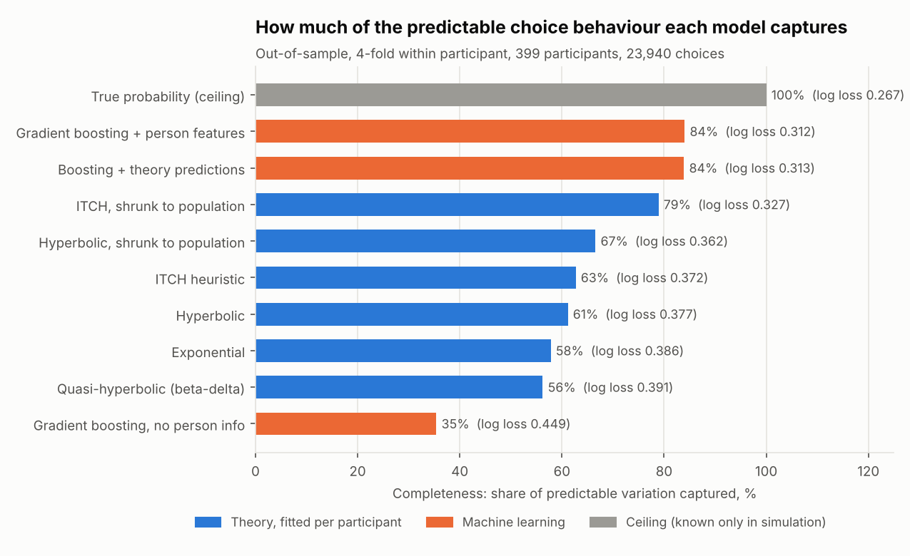
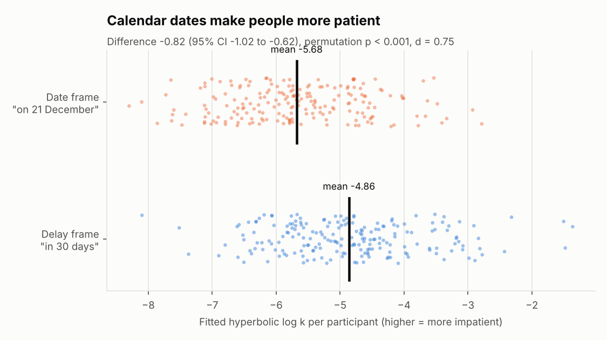
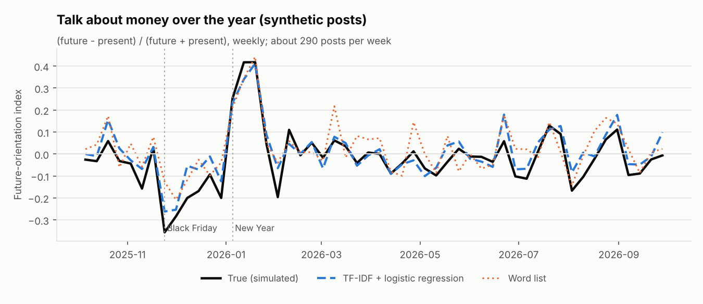

# Discount functions, heuristics or machine learning? Modelling intertemporal choice

[](https://colab.research.google.com/github/mohammedelsayed741996-blip/berlin-data-portfolio/blob/main/academic-research/time-preference-choice-models/notebooks/01_experiment_and_data_quality.ipynb)
[](https://colab.research.google.com/github/mohammedelsayed741996-blip/berlin-data-portfolio/blob/main/academic-research/time-preference-choice-models/notebooks/02_models_vs_machine_learning.ipynb)
[](https://colab.research.google.com/github/mohammedelsayed741996-blip/berlin-data-portfolio/blob/main/academic-research/time-preference-choice-models/notebooks/03_framing_effect_and_text_pilot.ipynb)

Why do people so often take a smaller reward now over a larger one later, and can that be changed? This project builds the full analysis for a study on that question: a simulated online experiment with 400 participants, pre-registered data-quality rules, four models of choice fitted to every participant, a comparison with machine learning, a framing intervention, a pilot that measures future orientation in text, a structured literature review and a working-paper draft.

I built it for a student assistant role at a chair of data science that works on time preferences. The role covers a literature review, the analysis of experimental choice data from discounting models to machine learning, possibly social-media data with NLP, and writing up the paper, and the project follows that order.

Everything runs on simulated data. Participant codes are random, the posts are generated from templates, and nothing describes a real person. Simulating has one big advantage: the true decision rule of every participant is known, so each method can be checked against the truth before real data come in.

## The experiment

- Each participant makes 60 choices between a smaller-sooner amount (5 to 80 euros, now or within 30 days) and a larger-later amount (2% to 150% more, 1 week to 6 months later), plus 4 catch trials where the later option is smaller.
- Half see delays ("in 30 days"), half see calendar dates ("on 21 December"). Read et al. (2005) found that dates make people more patient.
- The simulated population mixes hyperbolic, quasi-hyperbolic and exponential discounters with people who use the ITCH heuristic (Ericson et al. 2015) and do not discount at all. Discounters also show a magnitude effect: bigger amounts are discounted less.
- I added 16 careless responders and 12 repeat submissions. The exclusion rules, fixed before any model was fitted, removed all 16 careless responders and one genuine participant who failed two catch trials. That left 399 participants and 23,940 choices.

## Which model predicts choices best?

Every participant's trials were split into four folds, so each choice is predicted by a model that never saw it. The yardstick is completeness (Fudenberg et al. 2022): the share of the predictable variation a model captures, from 0% for the person's base rate to 100% for the true choice probability. With real data the ceiling has to be estimated. Here it is known exactly.



Fitted one person at a time, ITCH captures 63% and hyperbolic discounting 61%, and the two are statistically indistinguishable. Gradient boosting with person-level features captures 84%.

The interesting part is why. Without person information the booster drops to 35%, so most of its edge comes from pooling information across people rather than from a better rule for trading money against time. Giving the theory models the same pooling, by shrinking each person's estimates towards the population (empirical Bayes), lifts ITCH from 63% to 79%. For participants who really use the heuristic, shrunk ITCH captures 88% and beats the booster at 83%. Feeding the theory models' predictions into the booster adds nothing, because the person features already carry that information.

Recovery works where it should. For hyperbolic discounters, true and estimated log k correlate at 0.97. Telling the four decision types apart from 60 choices is harder: the lowest BIC picks the right type for 53% of participants (chance is 25%), and quasi-hyperbolic participants are the hardest to spot.

## Can time preferences be shaped?



Calendar dates lowered the fitted log k by 0.82 (95% CI 0.62 to 1.02, permutation p < 0.001, d = 0.76). They also raised the share of later choices from 62% to 75% and moved the present-bias parameter beta from 0.84 to 0.92. The effect barely changes without the exclusions (12.6 against 13.2 points).

The k estimate is larger than the factor I built in for discounters. Heuristic users react to the frame too, and a hyperbolic fit expresses their reaction as a change in k. That is why the model-free share of later choices belongs next to any parameter.

Larger amounts were discounted less, as Kirby and Maraković (1996) found. Comparing later amounts above and below 70 euros, log k is 0.50 lower for the larger ones (CI 0.41 to 0.59), for 75% of participants.

## Text pilot: future orientation in everyday posts



Fifteen thousand fictional posts about money, spread over a year, carry a built-in dip around Black Friday and a rise after New Year. Two simulated annotators labelled 900 posts and agreed on 84% (Cohen's kappa 0.76).

A TF-IDF and logistic regression classifier scores a macro F1 of 0.96 on a random split, but about 0.5 when whole phrasings are held out. The second test matters because new posts use wordings the labelled sample never had: on those, the classifier is right 63% of the time. Even so, its weekly index follows the true one closely (r = 0.93, against 0.84 for a word list), because errors average out over about 290 posts a week.

Correcting the counts for classification error made the index worse here, because the neutral class is rarely predicted, so I left that step out.

## Literature and paper

- [docs/literature_review.md](docs/literature_review.md) maps 11 papers by theme: discount functions, anomalies, heuristics, interventions and machine learning as a benchmark for theory. It records each paper's question, method, finding and use in this project. The same entries are in [docs/literature.csv](docs/literature.csv).
- [paper/paper.pdf](paper/paper.pdf) is a 10-page working-paper draft with the design, methods, results, discussion and limits. It is written in Markdown and built with pandoc.

## R replication

`r/fit_hyperbolic.R` repeats the exclusions, the hyperbolic fit per participant and the framing test in base R. CI runs it and checks the estimates against the Python version with `scripts/compare_r_python.py`.

## Run it

```bash
cd academic-research/time-preference-choice-models
pip install -r requirements.txt
python -m pytest                                  # 21 tests, about 1.5 minutes
PYTHONPATH=src python -m timepref.pipeline        # uses the cached cross-validation, about 1 minute
PYTHONPATH=src python -m timepref.pipeline --refresh   # recomputes it, about 4 minutes on 2 cores
python scripts/build_notebooks.py
pandoc paper/paper.md -o paper/paper.pdf --pdf-engine=xelatex --resource-path=paper
Rscript r/fit_hyperbolic.R data outputs/hyperbolic_fits_r.csv && python scripts/compare_r_python.py
```

```
src/timepref/
  config.py      design, simulated population, planted data problems, exclusion rules
  world.py       simulation of participants, trials and choices
  data.py        save and load the experiment files
  quality.py     pre-registered exclusion rules and participant flow
  models.py      exponential, hyperbolic, quasi-hyperbolic and ITCH, penalised maximum likelihood
  evaluate.py    cross-validation, gradient boosting, empirical Bayes, completeness, bootstrap
  effects.py     framing effect, magnitude effect, robustness to exclusions
  nlp.py         synthetic posts, annotator agreement, classifier vs word list, weekly index
  reporting.py   figures
  pipeline.py    runs everything
r/               base-R replication
docs/            literature review
paper/           working-paper draft
```

## Limits

- The data are simulated, so the numbers show what the methods can detect under known conditions. They are not findings about people.
- The mix of decision types, effect sizes and noise levels are my assumptions. More quasi-hyperbolic participants, for example, would change the ranking.
- Empirical Bayes is a two-step shortcut. A hierarchical Bayesian model fitted to everyone at once would be the principled version and would give uncertainty for each person.
- The text posts are templates and much more regular than real posts. Real social-media data would need an ethics review and GDPR safeguards: public posts only, pseudonymised authors and aggregated reporting.

Mohamed Abdelrasoul · MSc Data Analytics, Berlin · [LinkedIn](https://linkedin.com/in/mohamed-abdelrasoul-b07002173)
