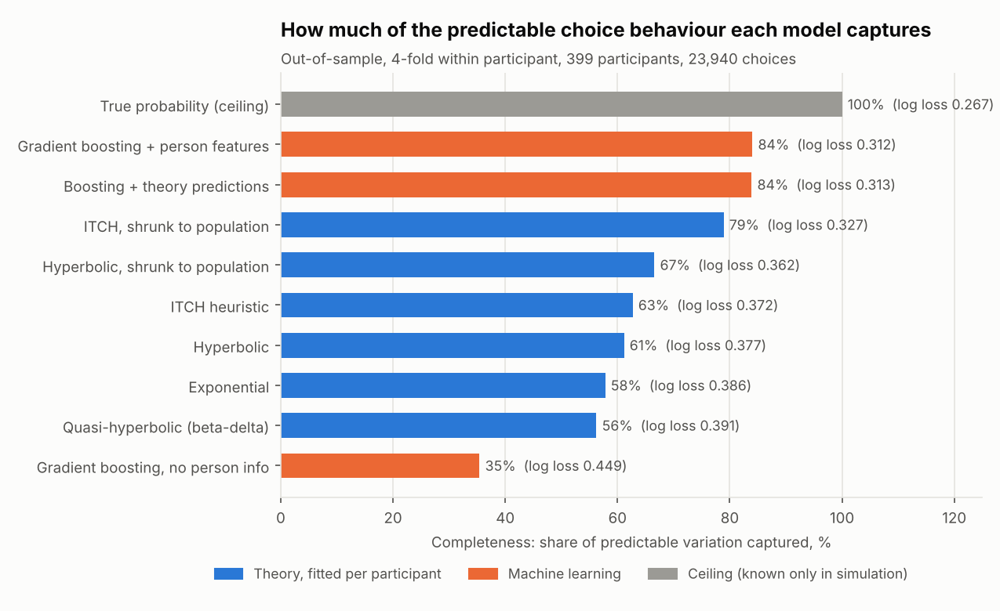
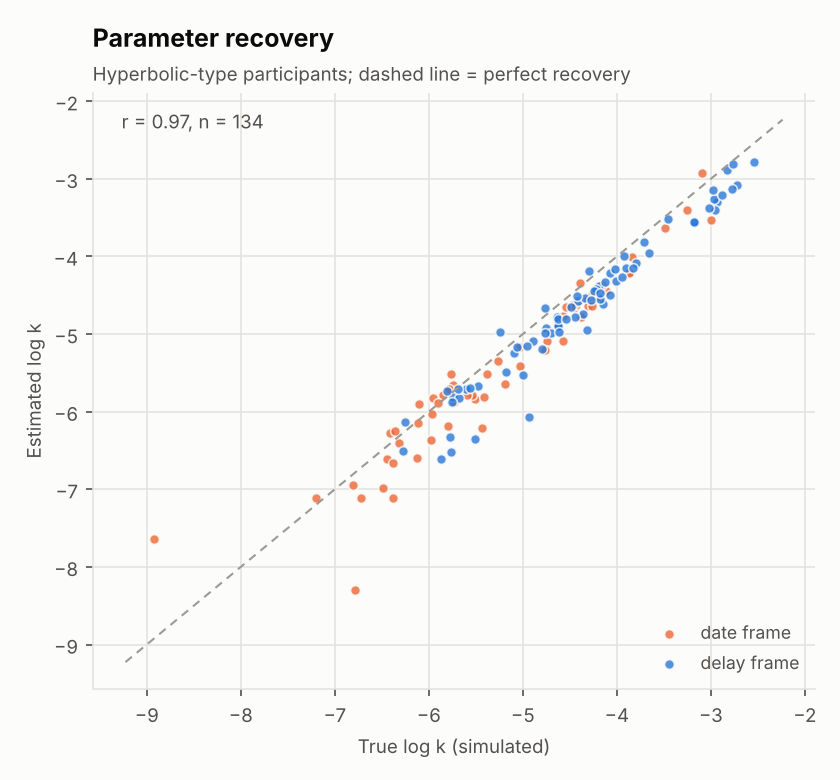
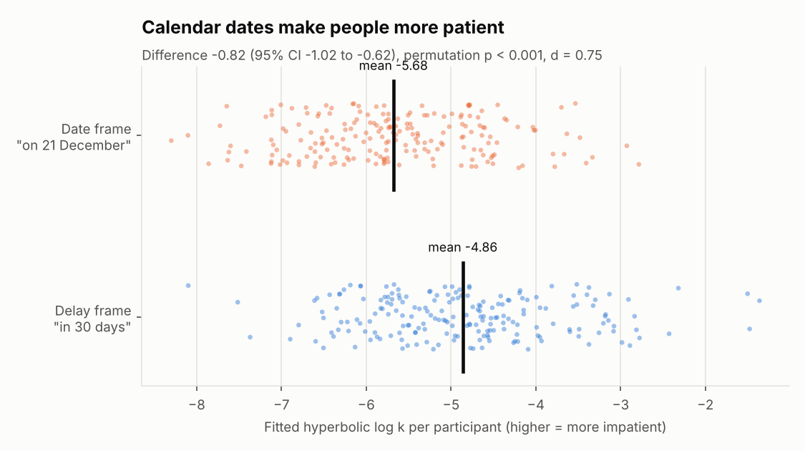
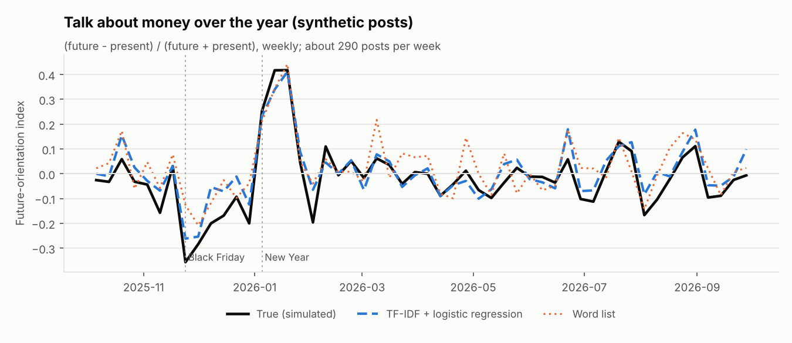

# 1. Introduction

People often take a smaller reward now over a larger one later, even when the later option is clearly worth more. Economists have long described this with a discount function, a rule for how fast the value of a reward falls with delay (Samuelson 1937; Mazur 1987; Laibson 1997). Psychologists have argued that many choices are better explained by heuristics that compare the options' attributes directly, without discounting anything (Ericson et al. 2015). Machine learning offers a third view: whatever the true process, a flexible predictor shows how much of the behaviour is predictable at all, and therefore how much any theory is missing (Peysakhovich and Naecker 2017; Fudenberg et al. 2022).

This draft sets up the full analysis for a study that addresses three questions:

1. Which model predicts individual choices best out of sample, and how complete is it?
2. Can parameters and decision types be recovered from about 60 choices per person?
3. Can time preferences be shaped by a cheap framing change, describing time as a calendar date rather than a delay (Read et al. 2005)?

A fourth, exploratory question asks whether future orientation can be measured in everyday text.

The data are simulated with a known generating process. This lets every step be checked against the truth before real data are collected: the exclusion rules, the estimators, the cross-validation, the effect estimates and the text measure.

# 2. Design

## 2.1 Simulated experiment

Participants made 60 binary choices between a smaller-sooner amount (5 to 80 euros, now, in 7 days or in 30 days) and a larger-later amount (2% to 150% more, 7 to 180 days later than the sooner option). Four catch trials offered a later option that was smaller than the sooner one, so choosing it signals inattention. Half the participants saw delays ("in 30 days"), half saw calendar dates ("on 21 December").

The simulated population mixes four decision types: hyperbolic discounters (34% of genuine participants), quasi-hyperbolic (28%), exponential (16%) and ITCH heuristic users (23%). Discounters show a magnitude effect: discount rates fall as amounts rise (Kirby and Maraković 1996). Date framing lowers the discount rate by a factor of 0.61, weakens present bias, and makes heuristic users weigh relative delay less. Choices are logistic in the value difference, and 2% of trials are random lapses.

Three data-quality problems were planted: 12 people took the study twice, 8 clicked at random, and 8 always chose the later option.

## 2.2 Pre-registered exclusions

The rules were fixed before any model was fitted:

- Keep each participant's first submission.
- Exclude anyone who failed two or more of the four catch trials.
- Exclude anyone whose median response time was below 450 ms.

## 2.3 Models

The three discounting models enter a logistic choice rule, $P(LL) = \sigma(\tau (V_{LL} - V_{SS}))$, with:

- exponential: $V = x e^{-rt}$
- hyperbolic: $V = x / (1 + kt)$
- quasi-hyperbolic: $V = \beta x e^{-rt}$ for delayed amounts and $V = x$ for immediate ones

ITCH is a logistic regression on the absolute and relative differences in money and time (Ericson et al. 2015).

Each model is fitted per participant by maximum likelihood with weak normal penalties. Without the penalties, a participant who always picks one side gets an infinite choice sensitivity.

The empirical-Bayes variants refit every participant with a prior centred on the population median, with a spread equal to the population's robust standard deviation.

Gradient boosting (scikit-learn's HistGradientBoostingClassifier) is trained on all participants together. It uses trial features (amounts, delays, ratios, relative delay, immediacy, implied interest rate, frame) and, in the "person features" variant, each participant's base rate and hyperbolic estimates from the training folds. A hybrid variant also receives the hyperbolic and ITCH predictions. On training rows these predictions come from an inner 3-fold split, so the booster never sees in-sample fits.

## 2.4 Evaluation

Each participant's 60 trials are split into four folds, and every trial is predicted by a model that did not see it. The headline measure is completeness (Fudenberg et al. 2022):

$$\text{completeness} = \frac{L_{\text{naive}} - L_{\text{model}}}{L_{\text{naive}} - L_{\text{best}}}$$

Here $L$ is the out-of-sample log loss, the naive model predicts each person's training base rate, and the best attainable loss uses the true simulated probabilities. With real data the true probabilities are unknown and a strong ML model has to stand in for them. Differences between models are tested with a bootstrap over participants.

# 3. Results

## 3.1 Data quality

Of 428 submissions from 416 participant codes, 17 participants were excluded. All 16 careless responders were among them. The speed rule caught every careless responder and the catch-trial rule caught 14 of the 16. One genuine participant who failed two catch trials was also excluded. Conditions stayed balanced (200 delay, 199 date). The framing effect on the share of later choices barely changes when the exclusions are dropped (13.2 against 12.6 percentage points), so the conclusions do not hinge on them.

## 3.2 Prediction

{width=88%}

| Model | Log loss | Accuracy | Completeness |
|---|---:|---:|---:|
| True probability (ceiling) | 0.267 | 88.3% | 100% |
| Gradient boosting + person features | 0.312 | 86.2% | 84% |
| Boosting + theory predictions | 0.313 | 86.4% | 84% |
| ITCH, shrunk to population | 0.327 | 86.3% | 79% |
| Hyperbolic, shrunk to population | 0.362 | 84.5% | 67% |
| ITCH | 0.372 | 85.6% | 63% |
| Hyperbolic | 0.377 | 84.5% | 61% |
| Exponential | 0.386 | 83.6% | 58% |
| Quasi-hyperbolic | 0.391 | 85.0% | 56% |
| Gradient boosting, no person information | 0.449 | 78.6% | 35% |
| Person's base rate (naive) | 0.549 | 72.7% | 0% |

: Out-of-sample performance, 399 participants, 23,940 choices.

Fitted per person, ITCH and hyperbolic discounting are statistically indistinguishable: the difference in log loss is −0.004 (95% CI −0.017 to 0.008). Gradient boosting with person features is clearly better than every per-person theory model.

Two comparisons show where its advantage comes from:

- **Without person information, boosting falls to 35%.** Knowing who is choosing matters more than any functional form.
- **Shrinkage closes most of the gap.** With ITCH estimates shrunk towards the population, completeness rises from 63% to 79%. The remaining distance to boosting is small but reliable: 0.014 in log loss (95% CI 0.009 to 0.020).

Adding theory predictions to the booster changes nothing (difference 0.000, CI −0.002 to 0.003). The person features already carry that information.

| True type | Exponential | Hyperbolic | Quasi-hyp. | ITCH | ITCH (shrunk) | Boosting |
|---|---:|---:|---:|---:|---:|---:|
| Exponential | 68% | 67% | 60% | 61% | 77% | 83% |
| Hyperbolic | 68% | 73% | 63% | 62% | 78% | 88% |
| Quasi-hyperbolic | 64% | 64% | 57% | 53% | 74% | 80% |
| ITCH | 28% | 35% | 41% | 76% | 88% | 83% |

: Completeness by the participant's true decision type.

Broken down by true type, the picture is sharper. For heuristic users, discounting models capture only 28% to 41% of the predictable variation, while shrunk ITCH captures 88% and beats gradient boosting. For discounters, boosting stays ahead, partly because the simulated magnitude effect is a pattern no fitted discounting model includes and the booster can learn.

## 3.3 Recovery

{width=55%}

For hyperbolic-type participants, estimated and true log k correlate at r = 0.97. Estimates are 0.23 lower on average. This matches the magnitude effect: the fitted model has one k for all amounts, and the trials' later amounts average above the 40-euro reference point at which the simulation sets k.

Telling decision types apart is harder. The lowest BIC picks the right type for 53% of participants, against 25% by chance. It is right for 64% of ITCH users and 62% of hyperbolic discounters, but only 36% of quasi-hyperbolic ones, who are often indistinguishable from exponential or hyperbolic discounters with 60 choices.

## 3.4 Shaping time preferences

{width=80%}

Date framing lowered hyperbolic log k by 0.82 (95% CI −1.02 to −0.62, permutation p < 0.001, Cohen's d = 0.76). It also raised the share of later choices from 62% to 75% (difference 13.2 points, CI 9.5 to 16.7) and the fitted present-bias parameter beta from 0.84 to 0.92. The estimate is larger than the factor built into the simulation for discounters (−0.5 in log k). Two things push it up:

- ITCH users react to the frame through their relative-delay weight, which a hyperbolic fit absorbs into k.
- Among the hyperbolic-type participants in this sample, the realised difference in true log k is −0.89, larger than the design value by chance.

Larger amounts were discounted less, as expected. Fitting k separately for later amounts below and above 70 euros, log k is 0.50 lower for the larger amounts (CI 0.41 to 0.59), and lower for 75% of participants.

## 3.5 Text pilot

{width=88%}

**Setup.** Fifteen thousand synthetic posts about money were generated over a year, with a built-in dip around Black Friday and in December and a rise after New Year.

**Labelling.** Two simulated annotators labelled 900 posts as present-oriented, future-oriented or neutral. They agreed on 84% (Cohen's kappa 0.76), and a third label settled disagreements.

**Generalisation.** A TF-IDF and logistic regression classifier reaches a macro F1 of 0.96 on a random split, but only 0.51 when whole phrasings are held out. This is the more honest test, because later posts use wordings the labelled sample never contained. On phrasings it has seen, the classifier is always right. On new phrasings it is right 63% of the time, and on mixed posts ("…but…") 61%. A simple word list scores 0.65 on the grouped test.

**Weekly index.** The classifier's weekly future-orientation index still follows the true index closely (r = 0.93), better than the word list (r = 0.84), because aggregation over about 290 posts a week averages out many individual errors.

**What did not work.** Correcting the weekly shares for the classifier's confusion matrix made the index worse. The neutral class is predicted too rarely, so the confusion matrix is close to singular.

# 4. Discussion

The main lesson for model comparison is that "theory against machine learning" mixes two separate questions:

- **Functional form.** Which rule turns money and time into a choice?
- **Pooling.** How much does each person's estimate borrow from everyone else?

Gradient boosting wins mostly on the second. Once theory models are given the same pooling through empirical Bayes, the heuristic model comes within 0.014 log loss of boosting overall and beats it for the people who actually use the heuristic. In a real study the natural next step is a hierarchical Bayesian model fitted to all participants at once, which pools in a principled way and gives uncertainty for each person's parameters.

The framing result shows that the pipeline recovers a moderate treatment effect with a tight interval from 400 participants. It also shows that the size of a framing effect depends on the model used to express it. A hyperbolic log k summarises behaviour from people who do not discount hyperbolically at all, so model-free outcomes such as the share of later choices should be reported alongside it.

The text pilot supports the plan to use social-media data as a complement. It also gives a concrete warning: a random split badly overstates how a classifier will do on language it has not seen. Real data should be split by time and by community, and labelled by trained annotators with agreement reported.

# 5. Limits

- All data are simulated. The numbers show what the methods can and cannot detect under known conditions. They are not findings about real people.
- The simulated decision types, effect sizes and noise levels are assumptions. A different mix, for instance more quasi-hyperbolic participants, would change the model ranking.
- Completeness uses the true probabilities as the ceiling. With real data the ceiling must be estimated, and completeness then depends on how strong the best available ML model is.
- The text data are templates, so they are far more regular than real posts. Real social-media data would also raise consent, platform-terms and GDPR questions: only public posts, pseudonymised authors, aggregated reporting, and an ethics review before collection.

# References

Ericson, K. M., and D. Laibson (2018). Intertemporal choice. NBER Working Paper 25358.

Ericson, K. M. M., J. M. White, D. Laibson, and J. D. Cohen (2015). Money earlier or later? Simple heuristics explain intertemporal choices better than delay discounting does. *Psychological Science* 26(6), 826–833.

Frederick, S., G. Loewenstein, and T. O'Donoghue (2002). Time discounting and time preference: A critical review. *Journal of Economic Literature* 40(2), 351–401.

Fudenberg, D., J. Kleinberg, A. Liang, and S. Mullainathan (2022). Measuring the completeness of economic models. *Journal of Political Economy* 130(4), 956–990.

Hershfield, H. E., D. G. Goldstein, W. F. Sharpe, J. Fox, L. Yeykelis, L. L. Carstensen, and J. N. Bailenson (2011). Increasing saving behavior through age-progressed renderings of the future self. *Journal of Marketing Research* 48(SPL), S23–S37.

Kirby, K. N., and N. N. Maraković (1996). Delay-discounting probabilistic rewards: Rates decrease as amounts increase. *Psychonomic Bulletin & Review*, 100–104.

Laibson, D. (1997). Golden eggs and hyperbolic discounting. *Quarterly Journal of Economics* 112(2), 443–477.

Mazur, J. E. (1987). An adjusting procedure for studying delayed reinforcement. In *Quantitative Analyses of Behavior*, Vol. 5. Hillsdale, NJ: Erlbaum.

Peysakhovich, A., and J. Naecker (2017). Using methods from machine learning to evaluate behavioral models of choice under risk and ambiguity. *Journal of Economic Behavior & Organization* 133, 373–384.

Read, D., S. Frederick, B. Orsel, and J. Rahman (2005). Four score and seven years from now: The date/delay effect in temporal discounting. *Management Science* 51(9), 1326–1335.

Samuelson, P. A. (1937). A note on measurement of utility. *Review of Economic Studies* 4(2), 155–161.

# Appendix: reproducibility

Code, data generator, notebooks and tests: github.com/mohammedelsayed741996-blip/berlin-data-portfolio, folder `academic-research/time-preference-choice-models`. The R script `r/fit_hyperbolic.R` repeats the exclusions, the hyperbolic fits and the framing test in base R. Continuous integration checks its estimates against the Python version.
