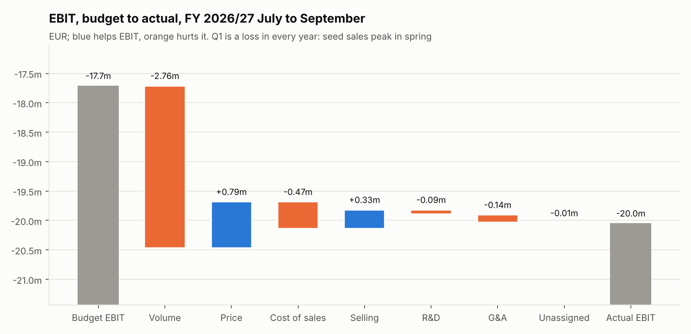
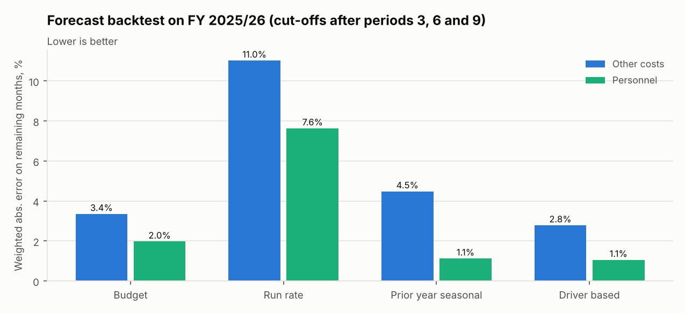
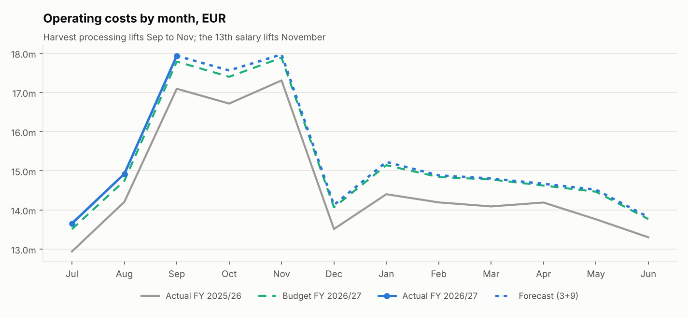
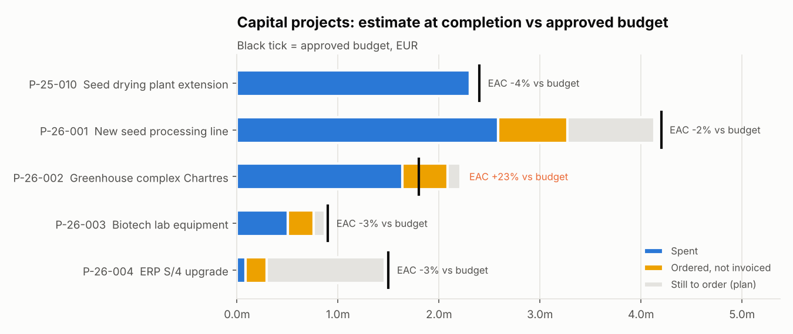

# Month-end close and rolling forecast for a seed breeding group

[](https://colab.research.google.com/github/mohammedelsayed741996-blip/berlin-data-portfolio/blob/main/agritech-corporate-finance/month-end-close-forecast/notebooks/01_month_end_close.ipynb)
[](https://colab.research.google.com/github/mohammedelsayed741996-blip/berlin-data-portfolio/blob/main/agritech-corporate-finance/month-end-close-forecast/notebooks/02_budget_vs_actual.ipynb)
[](https://colab.research.google.com/github/mohammedelsayed741996-blip/berlin-data-portfolio/blob/main/agritech-corporate-finance/month-end-close-forecast/notebooks/03_rolling_forecast_and_capex.ipynb)

I built this for working-student roles in controlling. It covers the work such a role supports every month: closing the books, explaining budget against actual, and updating the forecast for functional costs and investments.

The company is made up. Feldkern Group breeds and sells seed (sugarbeet, corn, cereals and vegetables) through three entities in Germany, France and Austria. Its fiscal year runs from July to June, because seed sales peak in spring. The project closes September 2026, period 3 of FY 2026/27, from a ledger extract shaped like an SAP line item table, then produces a 3+9 forecast and an Excel controlling pack.

All data is synthetic and generated by the code here. Vendors and users are codes such as `V0147` and `U04`; there are no names, addresses or bank details anywhere. Amounts are in euros.

## What it does

1. Generate the extract: about 31,800 ledger lines from July 2024 to September 2026: payroll, depreciation runs, rent, vendor invoices with goods receipts and GR/IR clearing, billing by crop, intercompany charges with quarterly settlement, capital projects on WBS elements, payments. There is also a budget with volumes and prices, a headcount plan, capex phasing and open orders. Eleven errors are planted in September.
2. Run 12 close checks on the September data and proposes correcting entries. Nothing is posted automatically.
3. Compare budget, actual and prior year by function, cost center and account, splits the revenue gap into volume and price, and explains each flagged line.
4. Pick forecast methods by backtest. Four methods forecast FY 2025/26 from three cut-offs. The best one per function and cost type then produces the FY 2026/27 forecast, starting from corrected actuals.
5. Write the outputs for finance: an Excel pack with live formulas, a close memo, and a Power BI star schema with DAX measures.

## Results for September 2026

### Close

The checks found all eleven planted errors, and December 2025, a month nobody touched, passes every check.

| Check | Status | Found |
|---|---|---|
| C01 Documents balance | FAIL | One upload from a feeder system off by EUR 1,250 |
| C02 Blocked cost centers | FAIL | EUR 8,900 on cost center 4199, locked since January 2025 |
| C03 Cost center belongs to the company | FAIL | A German posting on a French cost center, EUR 12,400 |
| C04 Expense lines have a cost center | FAIL | EUR 5,600 legal advice in France without one |
| C05 Duplicate vendor invoices | FAIL | Invoice RE-2026-08817 posted twice, EUR 42,350 |
| C06 Cut-off (working day 3) | WARN | Six invoices entered on 7 October |
| C07 Recurring postings | FAIL | Austrian depreciation run, rent for French sales and one IC charge are missing |
| C08 Intercompany | FAIL | DE10 and AT10 differ by EUR 19,331.50, the IC charge Austria never booked |
| C09 GR/IR older than 60 days | WARN | Four receipts from May and June with no invoice |
| C10 Suspense account | WARN | EUR 7,800 unidentified bank debit in France |
| C11 Billing vs ledger | PASS | |
| C12 Capex within 110% of budget | WARN | Greenhouse project at 116% spent plus ordered |

The proposed corrections add EUR 124k of cost. Reclasses net to zero; the rest is the missing postings minus the reversed duplicate.

### Budget vs actual

EBIT for July to September is EUR -20.0m against a budget of EUR -17.7m. Q1 is a loss every year, so the gap is what matters. Most of it is cereal seed: a dry autumn cut volume by 16%, and a price 4% above plan recovers only part of that.



At function level no line crosses the 10% and EUR 25k threshold, because errors in both directions cancel out. At cost center and account level twelve lines are flagged. Ten are explained by the data: energy prices above plan in production, the missing postings, the duplicate invoice, and a EUR 250k corn campaign invoice booked on corn breeding instead of corn sales. A matching function found that last one without being told where to look. The remaining two go to the cost center owners, because the data cannot explain them.

### Forecast

Run rate is the worst method in every backtest, because it misses the harvest peak and the 13th salary in November. The driver method wins six of the eight function and cost type cells and is never worse than the budget.



| | Outlook FY 2026/27 | Budget | Gap |
|---|---|---|---|
| Revenue | EUR 214.0m | EUR 218.8m | -2.2% |
| Cost of sales | EUR 91.7m | EUR 89.8m | energy |
| R&D | EUR 37.8m | EUR 38.4m | hiring behind plan |
| EBIT | EUR 29.9m (14.0% margin) | EUR 35.8m (16.4%) | -16.6% |



### Capex

Four of five projects will finish within budget. The greenhouse in France has spent and ordered 116% of its approved EUR 1.8m, and its estimate at completion is 23% over. It needs a budget supplement before more orders go out.



## Outputs

| File | What it is |
|---|---|
| `outputs/controlling_pack.xlsx` | Close checklist with a "close ready" formula, proposed entries, BvA by function, variance comments, revenue PVM, 3+9 forecast by month, outlook, capex and intercompany. Variances, totals and the outlook are Excel formulas. Inputs are blue. |
| `outputs/close_memo.md` | The close in one page of tables |
| `powerbi/` | `fact_cost` and `fact_revenue` with actual, adjustment, budget and forecast scenarios, five dimensions, `measures.dax` and `model.md` with the relationships |
| `sql/` | Trial balance, unbalanced documents, IC reconciliation, GR/IR aging, duplicate invoices and BvA in SQL. The tests check that they agree with the Python version |

## Notebooks

| Notebook | Content |
|---|---|
| [01 Month-end close](notebooks/01_month_end_close.ipynb) | The 12 checks, each finding, proposed entries, SQL versions, trial balance |
| [02 Budget vs actual](notebooks/02_budget_vs_actual.ipynb) | P&L by function, EBIT bridge, price and volume by crop, flagged lines, the misallocated invoice |
| [03 Rolling forecast and capex](notebooks/03_rolling_forecast_and_capex.ipynb) | Backtest, method choice, 3+9 forecast, outlook, capex EAC, Excel and Power BI outputs |

The notebooks are stored with their outputs. In Colab the first cell clones this repository, so they run without any setup.

## Run it

```bash
cd agritech-corporate-finance/month-end-close-forecast
pip install -r requirements.txt
python -m pytest                                          # 34 tests, about 20 seconds
PYTHONPATH=src python -m close_forecast.pipeline --regenerate
python scripts/build_notebooks.py                         # re-executes the notebooks
```

Or with Docker: `docker build -t close-forecast . && docker run --rm close-forecast`.

## How it is built

```
src/close_forecast/
  config.py          master data, planning assumptions, planted errors, thresholds
  fiscal.py          fiscal calendar (July to June), cut-off working days
  data_generator.py  ledger, budget, headcount, capex plan and orders
  close_checks.py    the 12 checks, trial balance, IC matrix, GR/IR items, proposed entries
  variance.py        BvA at any level, PVM, misallocation finder, P&L, comments
  forecast.py        four methods, backtest, method choice, 3+9 forecast, revenue, capex EAC
  reporting.py       charts, Excel pack, close memo, Power BI export
  db.py              SQLite loader for the SQL files
  pipeline.py        runs everything
```

A few choices worth explaining:

- Every expected cost comes from one function. The budget calls it with the planning assumptions, and actuals call it with noise and with what happened (energy at 118% of plan, R&D hiring 6% behind, the dry autumn). That way the variances have real causes the analysis can be checked against.
- The forecast starts from corrected actuals. A missing depreciation run or a misbooked invoice in September would otherwise be carried into nine forecast months.
- The PVM has no mix effect. The crops are sold in different units, so an average price across them would mean nothing.
- Checks return the offending lines, not a yes or no, so the Excel checklist and the notebook can show exactly what to fix.

## Limits

- Accruals, inventory valuation and FX are left out. All three entities report in euros.
- The extract is one table per source. A real SAP close would pull ACDOCA, cost center plans from ACDOCP and orders from EKKO/EKPO, and the field mapping would take most of the effort.
- Thresholds, the cut-off day and the capex tolerance are in `config.py`. In practice they come from the group's close calendar and investment policy.

Mohamed Abdelrasoul · MSc Data Analytics, Berlin · [LinkedIn](https://linkedin.com/in/mohamed-abdelrasoul-b07002173)
