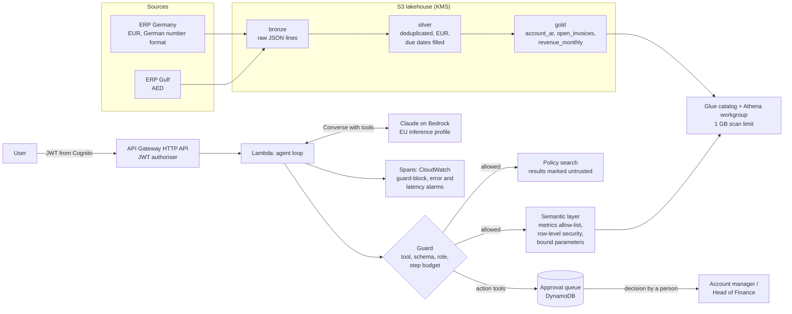

# Architecture

A Finance assistant for a fictional industrial distributor, Kestrel Industrial Supply. Account managers and Finance ask about receivables, revenue and credit policy; the agent answers from a governed lakehouse and drafts actions that people approve.

## Request flow
1. The API authoriser validates the token. The Lambda reads the user id and role from the token's claims; the request body only carries the question.
2. The planner (Claude on Bedrock in production, the rule planner offline) proposes a tool call.
3. The guard checks the call: known tool, arguments valid against the JSON schema, role allowed, step budget left. A blocked call becomes an observation the planner sees, so it can recover or stop.
4. Data tools go through the semantic layer, which compiles allowed metrics into parameterised SQL and adds `owner = ?` for account managers. Results are capped at 50 rows.
5. Action tools create approval requests. Nothing is sent until a person approves under the rules in ADR 0003.
6. Every step is a span with the guard's verdict, row count, tokens and estimated cost.

## Trust boundaries
| Boundary | What crosses it | Control |
|---|---|---|
| User to API | question, token | JWT authoriser, throttling (10 rps, burst 20) |
| Model to tools | tool name and arguments | guard: allow-list, JSON schema, role, step budget |
| Tools to data | metric, dimensions, filters | semantic layer allow-lists, bound parameters, row-level security |
| Documents to model | policy text, archived emails | wrapped as untrusted, injection patterns flagged |
| Agent to the outside world | reminders, credit holds | approval queue, four-eyes for credit holds |

## Decisions
See `adr/`. The short version: no free SQL (0001), access control in code (0002), people approve side effects (0003), Claude on Bedrock behind a planner interface (0004), a medallion lakehouse on S3 and Athena (0005), evaluation as a release gate (0006).
