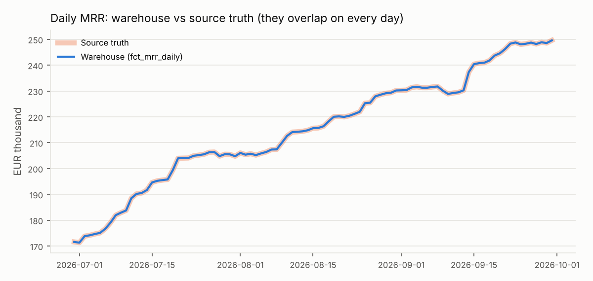
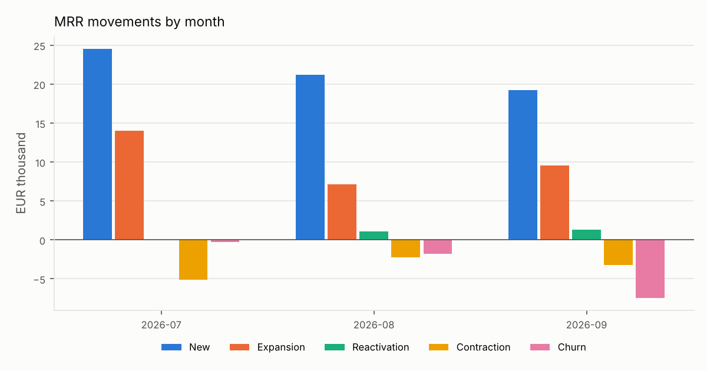
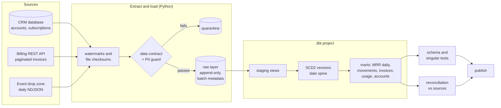

# Incremental ELT platform for SaaS revenue data

A data platform for a B2B software company whose revenue data lives in three systems: a CRM database, a billing REST API and daily event files from the product. Python loaders pull only what changed, check every record against a data contract, and append it to a raw layer. A dbt project turns that into revenue and usage marts. Reconciliation checks then prove the warehouse agrees with the sources.

The pipeline runs once a day for a simulated quarter (1 July to 30 September 2026). Six incidents are planted along the way to make sure every safeguard gets exercised.

| Notebook | What it shows | Run it |
|---|---|---|
| 01 Daily runs and incidents | 93 runs, the incident log, quarantine, schema drift, the outage day | [](https://colab.research.google.com/github/mohammedelsayed741996-blip/berlin-data-portfolio/blob/main/b2b-saas-data-platforms/saas-revenue-elt/notebooks/01_daily_runs_and_incidents.ipynb) |
| 02 Reconciliation and privacy | Control totals, known-answer checks, idempotent re-runs, GDPR controls | [](https://colab.research.google.com/github/mohammedelsayed741996-blip/berlin-data-portfolio/blob/main/b2b-saas-data-platforms/saas-revenue-elt/notebooks/02_reconciliation_and_privacy.ipynb) |
| 03 dbt models and revenue | Model graph, incremental SQL, SCD2 history, revenue bridge | [](https://colab.research.google.com/github/mohammedelsayed741996-blip/berlin-data-portfolio/blob/main/b2b-saas-data-platforms/saas-revenue-elt/notebooks/03_dbt_models_and_revenue.ipynb) |

## The problem

Finance wants MRR, churn and net revenue retention they can trust. Customer success wants product usage per account. Both depend on data that changes every day in systems the data team doesn't control. The API sometimes repeats records, fields appear without warning, someone types "Mid-Market" into a dropdown field, and a warehouse job occasionally falls over. The pipeline has to keep the numbers right through all of that, and show where each number came from.

## Results

| Check | Result over 93 daily runs |
|---|---|
| Runs | 92 succeeded. The one failure was the planted warehouse outage; the next day's run caught up. |
| Warehouse MRR vs true MRR from the source | Equal to the cent on all 93 days, including every upgrade, downgrade, churn and win-back |
| Usage events vs events actually delivered | Equal on all 92 days, despite 2,438 late events and 323 duplicates |
| Data tests | 2,852 executed, all passed |
| Reconciliation checks | 1,456 executed: 1,451 passed, 5 freshness warnings on a quiet CRM table |
| Invoices vs billing API control totals | Every month and currency reconciles; the one gap (EUR 295 in August) is fully explained by a quarantined invoice |
| Re-running a day | No new raw rows, same MRR |

| Planted incident | What the pipeline did |
|---|---|
| API repeats records across pages (20 Jul) | De-duplicated on invoice ID and version before load; control count shows the extra record |
| New field `discount_eur` appears (4 Aug) | Record kept, field stored in `_extra_json`, drift logged for a contract update |
| CRM writes `Mid-Market` instead of `MidMarket` (19 Aug) | Quarantined by the contract's enum check; the corrected value loaded the next morning |
| Invoice with a negative amount (29 Aug) | Quarantined; invoice reconciliation explains the difference to the cent |
| Five broken JSON lines in an event file (8 Sep) | Lines quarantined by position, the rest of the file loaded |
| Warehouse transform fails (13 Sep) | Three attempts, then downstream tasks skipped so nothing was published from stale tables; recovered on 14 Sep |

<p>


</p>

Full run report: [`outputs/run_report.md`](outputs/run_report.md). Model lineage: [`outputs/lineage.md`](outputs/lineage.md).

## Architecture



The orchestrator runs this as a daily DAG: four extract tasks, then transform, then tests and reconciliation in parallel, then publish. Each task retries, every attempt is logged, and a failed task stops everything downstream.

### How each part works

- Incremental extraction: the CRM is read with an `updated_at` watermark. The API is read with the same cursor minus a one-hour overlap to catch late commits at the source, and the overlap is removed again by de-duplicating on (key, version). Files are tracked by name and checksum; a re-delivered file with changed content replaces its earlier rows.
- Data contracts (`contracts/*.yml`): types, required fields, enums, patterns, ranges and row rules such as "gross equals net plus tax". The contract also says whether new fields are allowed. Each record that fails goes to `meta_quarantine` with its reasons.
- Raw layer: append-only, so history is never lost. Every row carries its batch ID, source reference and load time.
- dbt models: staging views pick the latest version of each record. `int_subscription_versions` builds SCD type 2 history straight from the raw layer. `fct_mrr_daily` reads the version valid at the end of each day. `fct_invoices` and `fct_product_usage_daily` are incremental, and the usage model re-aggregates a three-day window because events arrive late.
- Two engines: locally a small runner (`src/saas_elt/minidbt.py`) executes the dbt project on SQLite. It supports `ref`, `source`, `var`, `config`, `is_incremental`, seeds and generic plus singular tests. CI also runs the same project with real dbt on DuckDB. The few date functions that differ between engines sit in `macros/cross_db.sql`.
- Reconciliation (`src/saas_elt/reconcile.py`): control counts per batch, raw keys vs staging rows, invoice totals vs the API's own summary endpoint, freshness per source, and in the simulation an exact MRR check against the source truth.

## Privacy (GDPR and BDSG)

All data is synthetic, and the platform is built so that real data would be handled lawfully too:

- Data minimisation: contracts list exactly which fields may land. Unexpected fields fail, unless a contract explicitly allows drift.
- Pseudonymisation: product users only exist as salted SHA-256 hashes. The salt is read from the `EVENT_HASH_SALT` environment variable and is not stored in the code.
- PII guard: any record containing an e-mail address, phone number or IBAN is rejected, and the value is masked before the record is written to quarantine. Broken event lines are logged by file and line number only.
- Retention: quarantined records are deleted after 90 days.
- Right to erasure (Art. 17): `python -m saas_elt.cli erase --account ACC-00042 --request-id DSR-001` removes an account from every raw, model and quarantine table. The erasure log keeps only a hash of the ID. In production the same request must also reach the source systems, or the next extract would bring the data back.

## Run it

```bash
cd b2b-saas-data-platforms/saas-revenue-elt
pip install -r requirements.txt
python -m pytest -q                                        # 30 tests, about 40 seconds
PYTHONPATH=src python -m saas_elt.cli simulate --fresh     # 93 daily runs + outputs/run_report.md
PYTHONPATH=src python -m saas_elt.cli status               # failed tasks, quarantine, drift
```

To run the models with real dbt on DuckDB, which is what CI does:

```bash
pip install -r requirements-dbt.txt
python scripts/export_raw_to_duckdb.py workdir/warehouse/warehouse.db ci_warehouse.duckdb
cd dbt_project && DBT_DUCKDB_PATH=../ci_warehouse.duckdb dbt build --profiles-dir .
```

## Project layout

```
saas-revenue-elt/
├── contracts/            data contracts, one YAML per source
├── dbt_project/          models (staging, intermediate, marts), macros, seeds, tests, profiles.yml
├── notebooks/            01 runs and incidents, 02 reconciliation and privacy, 03 models and revenue
├── outputs/              run report, incident log, revenue bridge, lineage, charts
├── scripts/              notebook builder, SQLite to DuckDB export for CI
├── src/saas_elt/         simulator, contracts, ingest, warehouse, minidbt, orchestrator, reconcile, pipeline, reporting, cli
└── tests/                contracts, components, and integration tests on the full quarter
```

## Limits

- SQLite stands in for a cloud warehouse, so there is no clustering, cost control or concurrency here. The SQL is kept portable on purpose, and CI proves it runs on DuckDB.
- The orchestrator is deliberately small. On a real platform the same DAG would run in Airflow or Dagster; the task boundaries, retries and run log are designed to map one to one.
- `discount_eur` is detected as drift but not yet modelled. The next step would be contract version 1.1 and a staging column.

Built with Python, SQL, dbt, pandas, Jinja, networkx, pytest and GitHub Actions.
