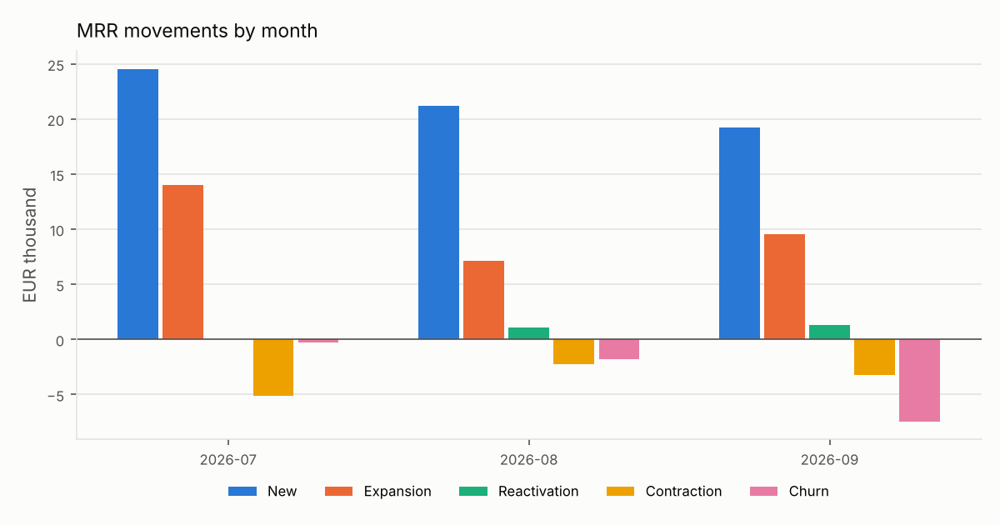
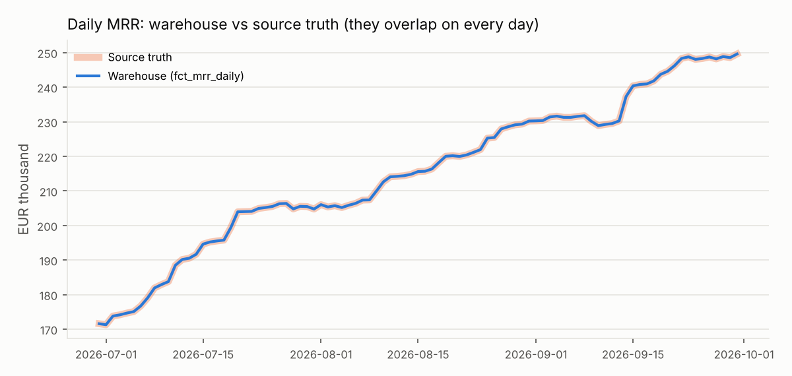
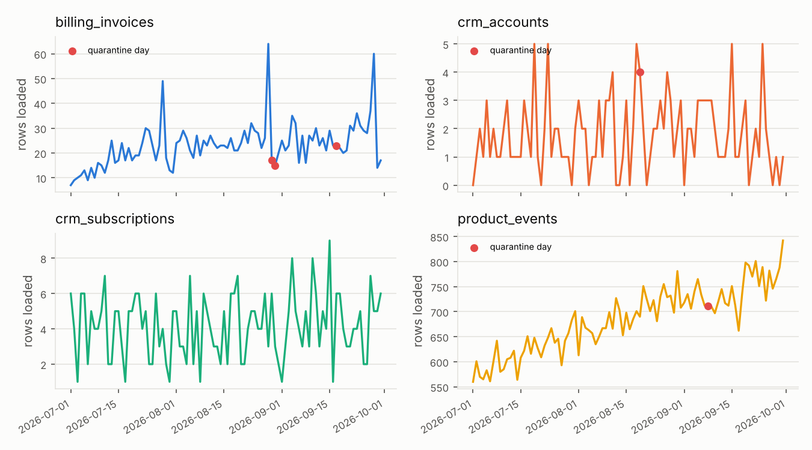

# Pipeline run report

Simulated daily runs from 2026-06-30 (initial load) to 2026-09-30.

| Metric | Value |
|---|---|
| Daily runs | 93 |
| Successful runs | 92 |
| Failed runs | 1 (2026-09-13) |
| Data tests executed | 2,852 (pass: 2,852) |
| Reconciliation checks | 1,456 (pass: 1,451, warn: 5) |
| Days where warehouse MRR = source MRR | 93 of 93 |
| Days where usage events = delivered events | 92 of 92 |

## Incidents

| date       | incident                  | how it was handled                                                                   | evidence                                                                                                                                                    |
|:-----------|:--------------------------|:-------------------------------------------------------------------------------------|:------------------------------------------------------------------------------------------------------------------------------------------------------------|
| 2026-07-20 | api_page_overlap          | De-duplicated on (invoice_id, updated_at); control count reconciled                  | API returned 29 records for 28 changed invoices (1 repeated across pages); 10 already-loaded versions dropped (page repeats plus the 1-hour overlap window) |
| 2026-08-04 | schema_drift              | Records kept, extra field stored in _extra_json, drift logged for a contract update  | New field(s) ['discount_eur'] first seen in batch billing_invoices:2026-08-04                                                                               |
| 2026-08-19 | bad_segment_value         | Contract enum check; dashboards kept the last valid segment                          | 1 account record quarantined; corrected version loaded the next day                                                                                         |
| 2026-08-29 | negative_invoice          | Contract min-value check; invoice reconciliation explains the difference             | 1 invoice quarantined; August EUR total reconciles with the gap fully explained                                                                             |
| 2026-09-08 | malformed_event_lines     | Rest of the file loaded; other files unaffected                                      | 5 broken line(s) quarantined by file and line number, content not stored                                                                                    |
| 2026-09-13 | transform_outage          | Retries, then fail fast; next day's run rebuilt the models from raw and caught up    | transform failed 3 attempts; downstream tasks skipped; next run's MRR check: pass                                                                           |
| every day  | late and duplicate events | Load-time de-duplication on event_id; 3-day look-back in the incremental usage model | 2,438 events arrived 1 to 2 days late; 323 duplicates dropped                                                                                               |

## Revenue bridge

| period_month   |   opening_mrr |   new_mrr |   expansion_mrr |   contraction_mrr |   churned_mrr |   reactivation_mrr |   closing_mrr |   net_revenue_retention |   gross_revenue_retention |
|:---------------|--------------:|----------:|----------------:|------------------:|--------------:|-------------------:|--------------:|------------------------:|--------------------------:|
| 2026-07-01     |        171575 |     24566 |           14011 |             -5119 |          -290 |                  0 |        204743 |                  1.0501 |                    0.9685 |
| 2026-08-01     |        204743 |     21240 |            7138 |             -2225 |         -1777 |               1073 |        230192 |                  1.0153 |                    0.9805 |
| 2026-09-01     |        230192 |     19228 |            9534 |             -3249 |         -7438 |               1313 |        249580 |                  0.995  |                    0.9536 |

