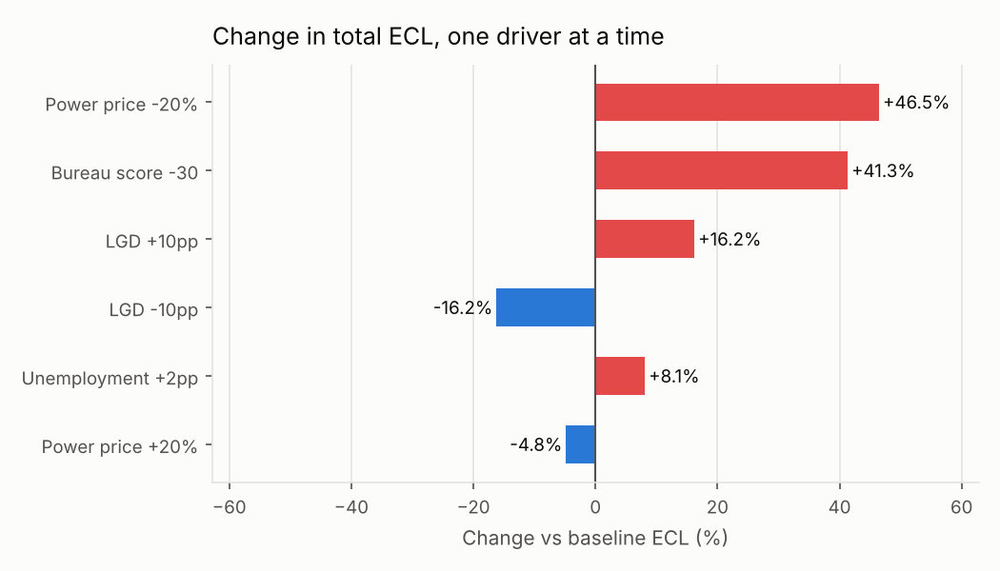
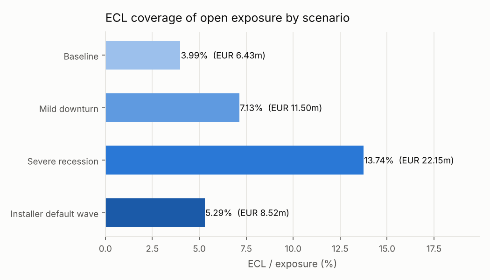
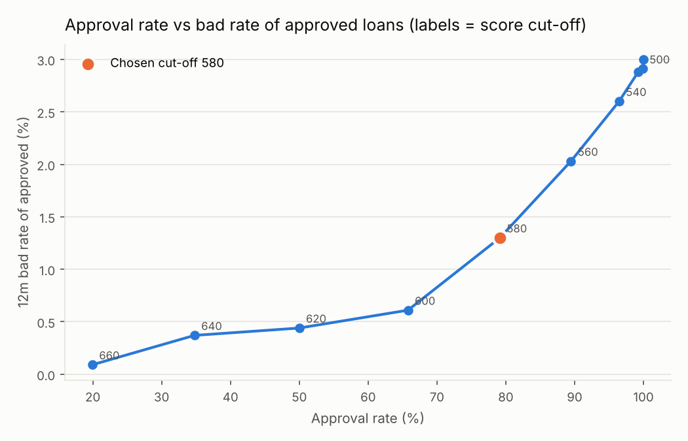
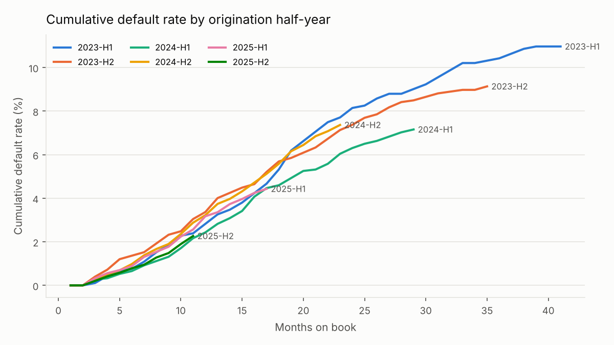
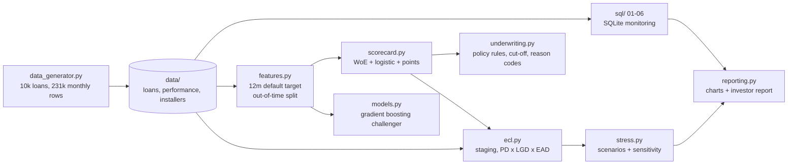

# Solar loan credit risk and stress testing

Credit risk toolkit for a lender that finances rooftop solar, home batteries and heat pumps through installer partners in Germany and Austria. It covers the work a portfolio management team does every month: score new applications, watch the live book, estimate expected losses, and show investors what happens when power prices or the economy turn.

| Notebook | What it covers | Run it |
|---|---|---|
| 01 Portfolio monitoring | Six SQL queries: delinquency, vintages, roll rates, installer concentration | [](https://colab.research.google.com/github/mohammedelsayed741996-blip/berlin-data-portfolio/blob/main/climate-tech-energy-finance/solar-loan-credit-risk/notebooks/01_portfolio_monitoring.ipynb) |
| 02 PD scorecard and underwriting | WoE scorecard vs gradient boosting, calibration tests, cut-off choice, reason codes | [](https://colab.research.google.com/github/mohammedelsayed741996-blip/berlin-data-portfolio/blob/main/climate-tech-energy-finance/solar-loan-credit-risk/notebooks/02_pd_scorecard_and_underwriting.ipynb) |
| 03 ECL and stress testing | IFRS 9 style staging, four scenarios, one-factor sensitivity, investor report | [](https://colab.research.google.com/github/mohammedelsayed741996-blip/berlin-data-portfolio/blob/main/climate-tech-energy-finance/solar-loan-credit-risk/notebooks/03_ecl_and_stress_testing.ipynb) |

The notebooks clone this repo when they start in Colab and need nothing beyond Colab's standard packages.

## The business problem

A green-energy lender grows by financing installations that installers sell. Every month it has to decide which customers to approve, and it has to convince the banks and funds behind its debt facilities that the book will hold up. That raises four questions:

1. Which applicants should we approve, and can we explain every decline?
2. Is the live book getting worse, and where?
3. How much do we expect to lose, stage by stage?
4. What happens to that loss if electricity gets cheaper, unemployment rises or a big installer goes bust?

One driver is specific to this kind of lending. A customer's solar savings help pay the loan, so the electricity price works like a credit risk factor. This project measures that effect.

## Results

All figures come from a synthetic book of 10,000 loans (EUR 155m open on 31 Oct 2026) and are reproducible from the fixed seed.

| Question | Answer |
|---|---|
| How well does the scorecard rank risk on loans it never saw? | Gini 0.64, KS 0.55 on the Jul 2024 to Oct 2025 vintages. The gradient-boosting challenger scored 0.97 AUC in training but only 0.81 out of time, so the scorecard stays champion. |
| Where should the cut-off sit? | Score 580: 79% approval, 1.3% 12-month bad rate on approved loans, against 3.0% with no cut-off. |
| Is the book deteriorating? | 0.56% of open balance is 30+ days late. 41% of 30-day arrears cure; 77% of 60-day arrears roll to default. |
| What is the expected loss? | EUR 6.4m (4.0% of exposure). Stage 1 needs 1.4%; most of the rest sits in 314 defaulted loans still in workout. |
| How bad is a severe recession? | ECL rises 3.4x to EUR 22.1m, mostly because 63% of exposure crosses into stage 2 and starts carrying a lifetime loss. |
| Which single driver matters most? | A 20% fall in power prices adds 47% to ECL, more than a 30-point drop in every customer's bureau score (+41%). |
| Any concentration issue? | The largest installer holds 16% of open exposure, above a 10% single-name limit, although the HHI of 521 looks unconcentrated. |

<p>




</p>

The full monthly report is in [`outputs/investor_report.md`](outputs/investor_report.md).

## How it works



Each step, in more detail:

- Target: Default means 90+ days past due within 12 months of origination. Loans younger than 12 months are left out, so a loan that simply hasn't had time to fail is never counted as good.
- Scorecard: Each feature is cut into quantile bins and converted to weight of evidence. Features under 0.02 information value are dropped (income and regional unemployment fell out). A logistic regression on the rest is scaled to points: 600 at 50:1 odds, 20 points to double the odds.
- Underwriting: Policy rules run before the score: debt-to-income over 45%, bureau score under 400, or PV savings covering less than 35% of the instalment. Then comes the cut-off, with a 20-point refer band below it. Declines list the three features that cost the applicant the most points.
- ECL: Stage 1 takes a 12-month loss. Stage 2 (30+ days late, or PD more than doubled since origination) takes a lifetime loss. Stage 3 is LGD times exposure. LGD comes from closed workouts by product, blended with a prior through a credibility weight. Delinquent loans use the observed 12-month roll-to-default rate (68% from 30 days, 90% from 60).
- Stress: Power price and bureau score shocks change the model inputs and are re-scored by the scorecard. Unemployment enters as a log-odds overlay, because it barely varied in the training data.

## Data

[`data_generator.py`](src/solar_credit/data_generator.py) builds the book from a known risk equation, so the models can be checked against a ground truth. It includes four products (PV, PV + battery, heat pump, PV + battery + wallbox), eleven regions in Germany and Austria, risk-based fixed rates between 3.8% and 9.4%, 120 installers with a Pareto-shaped volume split, monthly amortisation, cures, prepayments and recoveries collected 6 to 18 months after default.

There is no personal data. Borrowers and installers appear only as pseudonymous IDs (`LN-000123`, `INST-0042`). Names, addresses and birth dates are never generated, and a test checks that no such column appears. Age is not used as a feature.

## Assumptions and limits

- ECL is undiscounted and uses today's balance as exposure at default. Both make it slightly conservative.
- Lifetime PD fades by 20% a year after the first year, which matches the shape of the vintage curves. A production model would fit this term structure per segment.
- The unemployment elasticity (+0.12 log-odds per percentage point) and the 85% pass-through of power prices to PV savings are expert assumptions, not estimates.
- Heat pump savings are small compared with the instalment (median coverage 17%), so the savings-coverage policy rule only applies to PV products.
- One of five calibration grades shows more defaults than predicted at the 5% level. That goes on the watch list rather than triggering a recalibration on its own.

## Run it locally

```bash
cd climate-tech-energy-finance/solar-loan-credit-risk
pip install -r requirements.txt
python -m pytest -q                            # 26 tests, about 10 seconds
PYTHONPATH=src python -m solar_credit.pipeline # writes everything in outputs/
python scripts/build_notebooks.py              # re-executes the three notebooks
```

Add `--regenerate` to the pipeline command to rebuild the data from scratch. With Docker: `docker build -t solar-credit . && docker run --rm solar-credit`.

## Project layout

```
solar-loan-credit-risk/
├── data/                 synthetic loan book (CSV, performance is gzipped)
├── notebooks/            01 monitoring, 02 scorecard, 03 ECL and stress
├── outputs/              metrics, tables, charts, investor_report.md
├── scripts/              notebook builder
├── sql/                  six monitoring queries (SQLite, portable to Snowflake/Postgres)
├── src/solar_credit/     config, data, features, scorecard, models, underwriting, ecl, stress, monitoring, reporting, pipeline
└── tests/                pytest suite: data integrity, model checks, ECL maths, SQL vs pandas
```

Built with Python, pandas, scikit-learn, SciPy, SQL and matplotlib.
