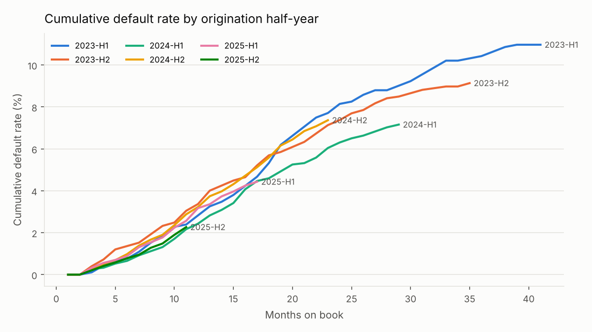
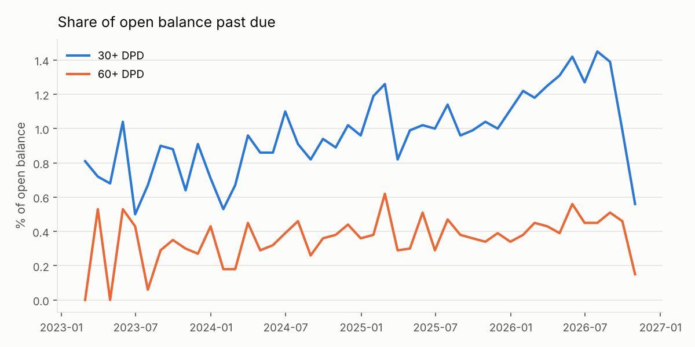
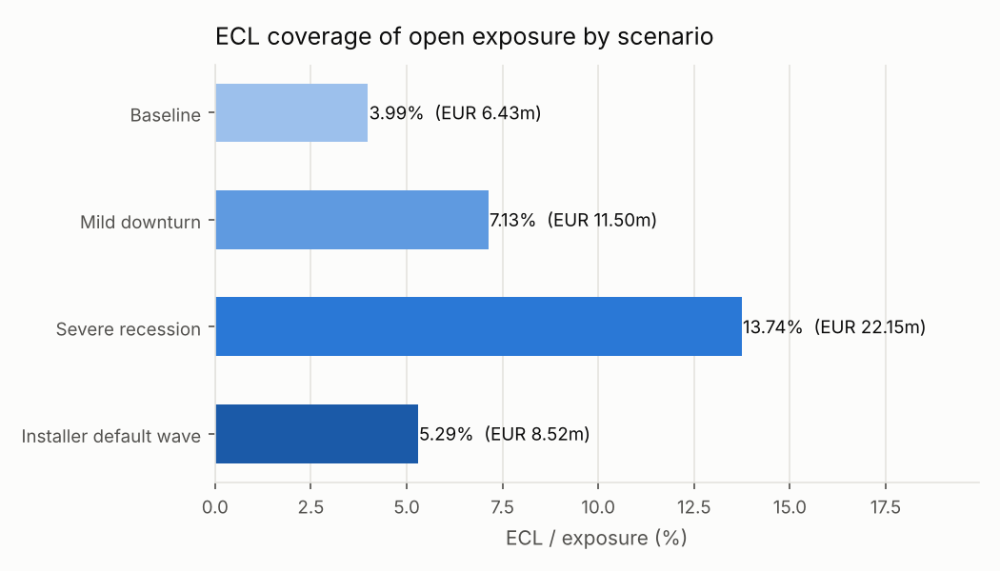
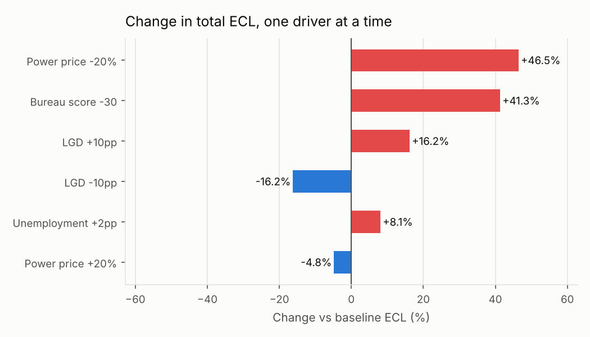
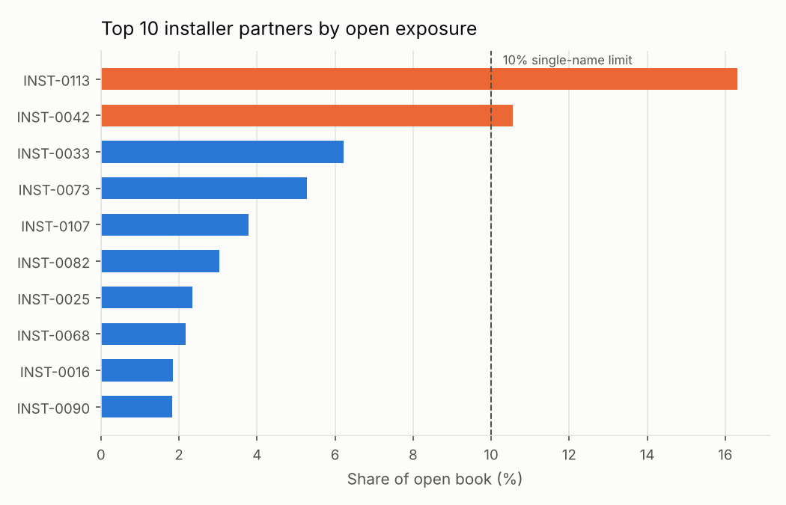

# Residential energy loan portfolio: investor report

As of 2026-10-31. Synthetic data, built to show the reporting workflow.

## Portfolio at a glance

| Metric | Value |
|---|---|
| Open loans | 8,520 |
| Open exposure | EUR 155.16m |
| 30+ DPD share of balance | 0.56% |
| Loans in open workout (defaulted) | 314 |
| Lifetime defaults to date | 672 (6.72% of loans written) |
| Largest installer share of book | 16.3% |
| Installer HHI | 521 |

## Expected credit loss (IFRS 9 style, baseline)

| stage | loans | exposure_eur | ecl_eur | coverage |
|---|---|---|---|---|
| 1 | 8468 | EUR 154.29m | EUR 2.16m | 1.40% |
| 2 | 52 | EUR 872,292 | EUR 537,195 | 61.58% |
| 3 | 314 | EUR 6.09m | EUR 3.74m | 61.28% |

Total ECL is EUR 6.43m, or 3.99% of exposure.

## Stress tests

| scenario | avg_pd_12m | stage2_share_of_exposure | ecl_eur | ecl_coverage | ecl_vs_baseline |
|---|---|---|---|---|---|
| Baseline | 2.84% | 0.5% | EUR 6.43m | 3.99% | 1.00x |
| Mild downturn | 4.03% | 30.5% | EUR 11.50m | 7.13% | 1.79x |
| Severe recession | 6.39% | 62.7% | EUR 22.15m | 13.74% | 3.44x |
| Installer default wave | 2.84% | 0.5% | EUR 8.52m | 5.29% | 1.32x |

The severe scenario raises ECL to 3.44x the baseline.
The largest single driver in the sensitivity run is "Power price -20%" (+46.5% ECL).

## Model performance (12-month PD, out-of-time test)

| Model | AUC | Gini | KS | Brier | Predicted DR | Observed DR |
|---|---|---|---|---|---|---|
| Scorecard (champion) | 0.8189 | 0.6379 | 0.5474 | 0.02778 | 2.83% | 3.00% |
| Gradient boosting (challenger) | 0.8082 | 0.6164 | 0.5081 | 0.02781 | 2.73% | 3.00% |

Underwriting cut-off: score 580 (approval rate 79.1%, 12m bad rate of approved loans 1.30% on the test vintages).

## Concentration: top 5 installers

| installer_id | installer_region | open_loans | exposure_eur | share_of_book | lifetime_default_rate |
|---|---|---|---|---|---|
| INST-0113 | Baden-Wuerttemberg | 1417 | EUR 25.31m | 16.3% | 6.2% |
| INST-0042 | Brandenburg | 888 | EUR 16.37m | 10.5% | 6.4% |
| INST-0033 | Baden-Wuerttemberg | 534 | EUR 9.64m | 6.2% | 6.8% |
| INST-0073 | Schleswig-Holstein | 446 | EUR 8.18m | 5.3% | 10.3% |
| INST-0107 | Nordrhein-Westfalen | 329 | EUR 5.87m | 3.8% | 5.0% |

## Charts

