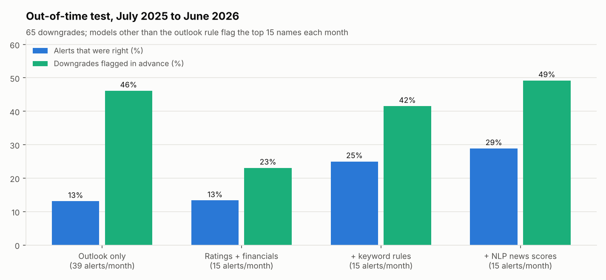
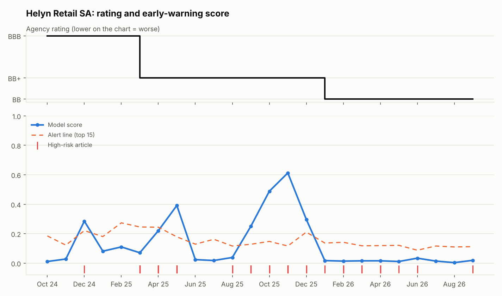
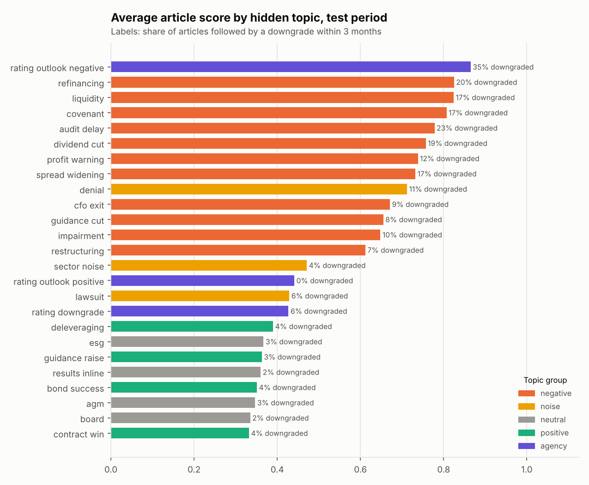

# Credit downgrade early warning from financial news

[](https://colab.research.google.com/github/mohammedelsayed741996-blip/berlin-data-portfolio/blob/main/consulting-financial-services/credit-downgrade-early-warning/notebooks/01_data_and_news.ipynb)
[](https://colab.research.google.com/github/mohammedelsayed741996-blip/berlin-data-portfolio/blob/main/consulting-financial-services/credit-downgrade-early-warning/notebooks/02_models_and_alerts.ipynb)
[](https://colab.research.google.com/github/mohammedelsayed741996-blip/berlin-data-portfolio/blob/main/consulting-financial-services/credit-downgrade-early-warning/notebooks/03_model_validation.ipynb)

A bank's credit team covers hundreds of rated companies and can look closely at maybe fifteen a month. Rating agencies move late. This project asks whether English and German news can tell the team which fifteen to look at, before the downgrade.

I built it for data and analytics consulting roles in financial services. It goes through the whole case: frame the decision, build the data, train an NLP model and a second-stage model, compare against what the client already uses, validate the model the way a bank's model risk team would, and explain each alert in plain words.

All data is synthetic and generated by the code. The 360 issuers have made-up names, no article names a person, and nothing refers to a real company.

## The setup

- 360 European issuers in ten sectors, rated AA to CCC, January 2022 to September 2026.
- Each issuer has a hidden credit score that moves with sector shocks (real estate after the 2022 rate rise, chemicals on gas prices, automotive in 2024/25), slow deteriorations and rare sudden events. The agency rating follows it one to three months late, and outlook changes come only when the agency reviews the name.
- About 66,000 news articles, two thirds English and one third German. The topic mix follows each issuer's hidden path, with noise on purpose: bad headlines for healthy companies, upbeat releases from troubled ones, denials, and sector stories that mention a company without being about it.
- Quarterly financials published two months after quarter end, and monthly share prices for listed issuers.
- Target: downgrade in the next three months, for every issuer and month. Training runs to March 2025, the test covers July 2025 to June 2026, and the three months in between are left out so no training label sees the test period.

## How it works

1. An article model scores every news item. The text is cleaned first: the issuer name, sector, city, quarter and all numbers are masked, and words after a negation get a `neg_` prefix. Then TF-IDF on words, word pairs and character n-grams (which handle German compounds) feeds a logistic regression. Training articles get out-of-fold scores, five folds grouped by issuer.
2. An issuer model (gradient boosting) combines the article scores of the last one and three months with the rating, outlook, financials, share price and a standard list of red-flag keywords.
3. Each month the 15 highest-scoring issuers form the analysts' review list, each with its strongest article and the words that drove its score.

## Results on the test period

65 downgrades happened in the test window. Every model except the outlook rule gets the same review budget of 15 names a month.

| Model | Alerts a month | Alerts that were right | Downgrades flagged in the 3 months before | PR-AUC |
|---|---|---|---|---|
| Negative outlook (what many teams use) | 39 | 13% | 30 of 65 | 0.07 |
| Ratings + financials | 15 | 13% | 15 of 65 | 0.08 |
| + keyword rules | 15 | 25% | 27 of 65 | 0.19 |
| + NLP news scores | 15 | 29% | 32 of 65 | 0.26 |

The base rate is 3.9%, so an alert from the full model is about seven times more likely than a random name to be followed by a downgrade. It catches more downgrades than the outlook rule with less than half the review work.



Shuffling one feature group at a time shows where the signal comes from: the NLP scores carry most of it (PR-AUC drops by 0.21 without them), the rating and outlook come second, and financials add almost nothing. They arrive two months late and are noisy.



Helyn Retail SA made the review list in September 2025, after a profit warning, the sudden exit of its chief financial officer, a request for a covenant waiver and a draw on its credit line. The agency moved the outlook to negative in December and downgraded the company in January 2026, four months after the first alert.

## Validation

The test-set numbers are not enough for a model that reads language, so the text model also gets fixed inputs with known right answers. These are the same kind of tests you would run on a GenAI chatbot before a bank lets customers use it.

| Test | Result |
|---|---|
| Company name changes the score | No (20 of 20 names give the same score) |
| A denial scores lower than the problem it denies | 4 of 5, but only slightly |
| Adding a red flag raises the score | 2 of 3 |
| Hand-written sentences in wording the templates never use | 7 of 12 correct |

Two of these findings changed the model:

- The first version did not mask sectors, cities or quarters, and its strongest words were "transport", "utilities" and "automotive". Sector shocks and reporting seasons lined up with downgrades in the training years, so it had learned the calendar. Masking removed that shortcut.
- Denials score almost as high as admissions. Checking against the hidden topics showed why: issuers that denied problems were downgraded within three months about 11% of the time, three to four times the rate after neutral news. So the model is right here, and the test was wrong to expect otherwise. That needs checking on real data before anyone relies on it.



The weak result on unseen wording is the main limit. A bag-of-words model learns the phrasing it was trained on. On real news it would need human-labelled articles and most likely a multilingual transformer or an LLM classifier, tested with the same sentences. English and German work about equally well (article AUC 0.68 and 0.69).

## Outputs

| File | What it is |
|---|---|
| `outputs/watchlist_2026-09.md` | The live list for September 2026: 15 issuers with rating, outlook, score, strongest article and the words behind it |
| `outputs/model_card.md` | Purpose, data, design, results, validation and limits on one page |
| `outputs/figures/` | Model comparison, precision-recall curves, one issuer's story, score by topic |
| `outputs/summary.json`, `evaluation.csv` | The numbers behind the README |

## Notebooks

| Notebook | Content |
|---|---|
| [01 Data and news](notebooks/01_data_and_news.ipynb) | Issuers, rating dynamics, what the news looks like, how topics shift under stress, the target and the time split |
| [02 Models and alerts](notebooks/02_models_and_alerts.ipynb) | What the text model learned in English and German, four models compared, one issuer end to end, the live watchlist |
| [03 Model validation](notebooks/03_model_validation.ipynb) | The shortcut that was removed, behavioural tests, score by topic, languages, sectors, calibration, model card |

The notebooks are saved with their outputs. In Colab the first cell clones this repository, so they run without setup.

## Run it

```bash
cd consulting-financial-services/credit-downgrade-early-warning
pip install -r requirements.txt
python -m pytest                                        # 23 tests, about 90 seconds
PYTHONPATH=src python -m downgrade_ews.pipeline --regenerate
python scripts/build_notebooks.py
```

```
src/downgrade_ews/
  config.py      universe size, sectors and shocks, rating scale, time split, review budget
  world.py       issuers, hidden credit path, agency ratings, financials, share prices
  news.py        English and German article templates, topic mix driven by credit stress
  data.py        build, save and load
  features.py    masking, negation marking, targets, article model, point-in-time features
  models.py      four issuer models, alert lists, event-level metrics
  explain.py     top terms, the words behind one article, the articles behind one alert, group importance
  validation.py  behavioural tests, score by topic, languages, sectors, calibration
  reporting.py   charts, watchlist, model card
  pipeline.py    runs everything
```

The tests check, among other things, that no article or financial statement from after the as-of month reaches a feature, that the target matches the rating actions, that training articles are scored out of fold, and that the full model beats the keyword model.

Mohamed Abdelrasoul · MSc Data Analytics, Berlin · [LinkedIn](https://linkedin.com/in/mohamed-abdelrasoul-b07002173)
