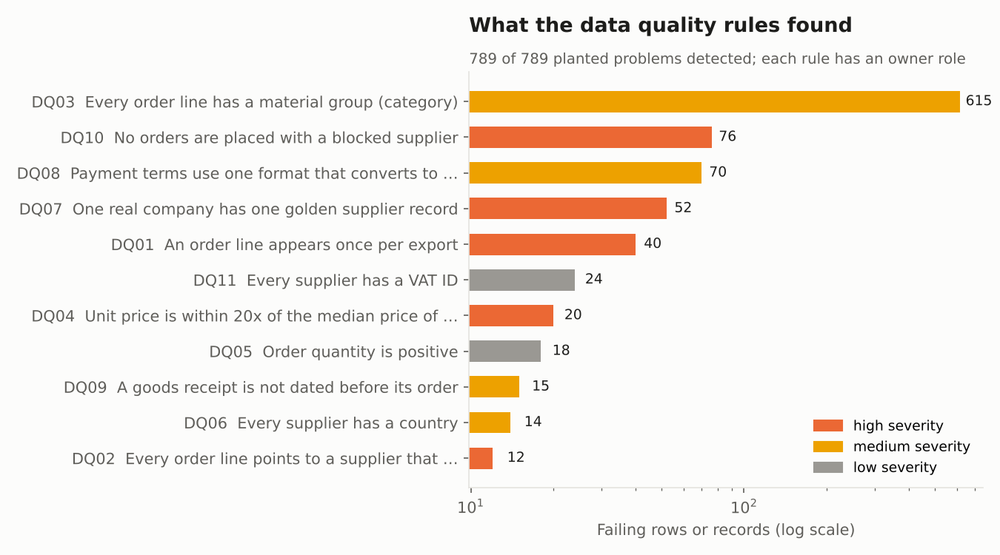
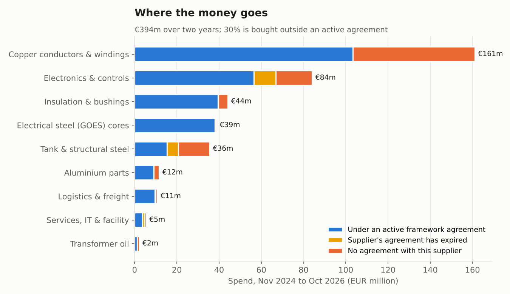
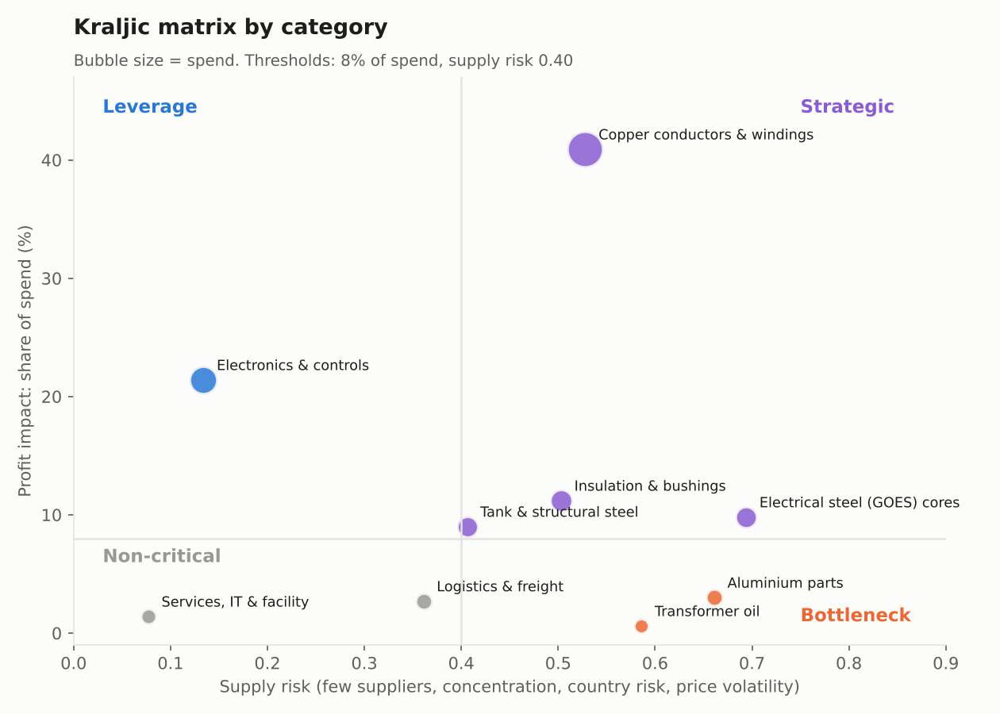
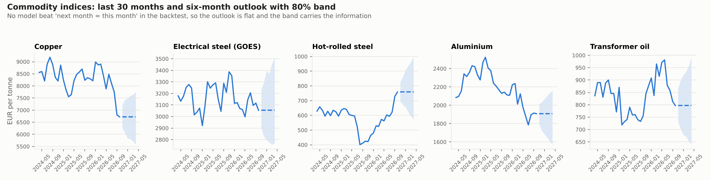

# Procurement spend cube, data quality and commodity price forecasting

A procurement analytics setup for a fictional maker of power transformers, Havelwerk Grid Components, with plants in Berlin, Erfurt and Gdansk. It takes raw exports from two ERP systems, checks them against twelve data quality rules, merges duplicate suppliers into golden records, builds a spend cube, scores suppliers, and forecasts the commodity prices that drive half of the purchase volume. The results go into an Excel workbook, a Power BI model and a management deck in German.

All data is synthetic. The generator invents suppliers, materials, orders and price indices, and plants known data problems so the checks can be scored. No real company, person or price appears anywhere.

| Notebook | What it shows | Open |
|---|---|---|
| 1. Data sources and quality | source profiling, 12 rules, supplier matching and the review queue | [](https://colab.research.google.com/github/mohammedelsayed741996-blip/berlin-data-portfolio/blob/main/energy-grid-technology/procurement-spend-analytics/notebooks/01_data_sources_and_quality.ipynb) |
| 2. Spend cube and suppliers | SQL views, contract coverage, Pareto, concentration, scorecard, Kraljic | [](https://colab.research.google.com/github/mohammedelsayed741996-blip/berlin-data-portfolio/blob/main/energy-grid-technology/procurement-spend-analytics/notebooks/02_spend_cube_and_suppliers.ipynb) |
| 3. Commodity prices and budget | forecast backtest, prediction bands, index pass-through, budget impact | [](https://colab.research.google.com/github/mohammedelsayed741996-blip/berlin-data-portfolio/blob/main/energy-grid-technology/procurement-spend-analytics/notebooks/03_commodity_prices_and_budget.ipynb) |

## Kurzfassung (Deutsch)

Zwei ERP-Systeme, ein Vertragsverzeichnis und Rohstoffindizes werden zu einem Spend Cube zusammengeführt. Zwölf Datenqualitätsregeln mit verantwortlicher Rolle und Maßnahme finden alle 789 absichtlich eingebauten Fehler. Aus 167 Lieferantenstammsätzen werden 115 Golden Records, ohne falsche Zusammenführung; 15 Grenzfälle gehen zur manuellen Prüfung. 70 % des Volumens laufen über aktive Rahmenverträge, 17 Mio. € entfallen auf Lieferanten mit ausgelaufenem Vertrag. Bei den Rohstoffpreisen war kein Modell besser als „nächster Monat = dieser Monat“, deshalb arbeitet die Budgetplanung mit Bandbreiten, die im Backtest zu 80 % trafen. Die Management-Präsentation (`outputs/management_summary_de.pptx`) ist auf Deutsch.

## What comes in

| Source | Format | Problems found in it |
|---|---|---|
| ERP_A order lines (Berlin, Erfurt) | SAP-style fields, semicolons, German numbers and dates, prices per 100 units for cheap items | 40 duplicate lines from overlapping exports, 12 lines with a supplier missing from the master, 76 lines with a blocked supplier |
| ERP_B order lines (Gdansk) | ISO dates, prices in PLN | 615 lines without a category, 20 copper lines priced per tonne on a per-kg line, 18 returns as negative quantities |
| Supplier masters (both) | different IDs, names typed differently | 52 duplicate records, 14 without a country, 24 without a VAT ID, payment terms in six formats |
| Goods receipts, quality notifications, contracts, commodity indices | CSV | 15 receipts dated before their order |

[docs/data_sources.md](docs/data_sources.md) profiles every column. [docs/data_governance.md](docs/data_governance.md) has the lineage, an ownership table by role and the definitions (spend, on contract, maverick, on time, pass-through).

## Data quality and supplier matching

Each rule in [config/dq_rules.yaml](config/dq_rules.yaml) has a DAMA dimension, a severity, an owner role and an action. The pipeline fixes only what is unambiguous (duplicate export lines, per-tonne prices, PLN, SAP price units, missing categories classified from the description) and reports the rest.

Suppliers merge when they share a VAT ID, or when their normalised names match and nothing conflicts. A pair with different VAT IDs or legal forms stays apart and goes to a review list, which is how "Ruhr Stahlbau S.A." and "Ruhr Stahlbau Sp. z o.o." remain two companies. Against the answer key the matching found all 55 duplicate pairs with no false merges. That is a check against problems I planted myself, so on real data I would expect the review list to do more of the work.



## Spend and suppliers

| Measure | Result |
|---|---|
| Spend, Nov 2024 to Oct 2026 | €394m across 112 suppliers |
| Suppliers carrying 80% of spend | 17 |
| Under an active framework agreement | 70% |
| With suppliers whose agreement expired end of 2025 | €17m |
| With suppliers that have no agreement, in categories that have agreements | €100m |
| Goods received on time (within 2 days) | 89% |



The supplier scorecard combines on-time delivery, defect rate and country risk. The largest supplier, a copper wire maker with €57m of spend, scores a D because only 79% of its deliveries arrive on time. The Kraljic matrix places copper, electrical steel, insulation and tank steel as strategic, electronics as leverage, and aluminium and transformer oil as bottlenecks: small spend but few suppliers and volatile prices. Electrical steel has one supplier with 98% of the volume.



The analysis runs as SQL views in [sql/views.sql](sql/views.sql) (window functions for the Pareto and moving averages, a Herfindahl index for concentration). The same star schema loads into Power BI with [powerbi/load_star_schema.pq](powerbi/load_star_schema.pq) and [powerbi/measures.dax](powerbi/measures.dax).

## Commodity prices

Five models forecast copper, electrical steel, hot-rolled steel, aluminium and transformer oil one to six months ahead, refitted every month from October 2023:

| Model | Mean error, all indices and horizons |
|---|---|
| Naive (next month = this month) | 7.75% |
| AR on monthly returns (ridge) | 7.84% |
| Holt, damped trend | 8.03% |
| Drift | 8.17% |
| Seasonal naive | 11.16% |

No model beat the naive forecast by more than the 5% I required before using it, so the outlook stays flat. What helps a buyer is the band: the 80% bands built from past price moves held 80.4% of the actual outcomes in the backtest.



The order data also shows how prices follow the indices. Regressing each category's prices on the index at lags of zero to three months recovers the contract formulas: 73% of the copper price follows the copper index with a one-month delay, 67% of electrical steel follows its index with two months. With these, the six-month budget effect for copper at current volumes is about −€3.4m, with an 80% range from −€6.0m to −€0.8m.

## Outputs

| File | For |
|---|---|
| `outputs/procurement_spend_cube.xlsx` | buyers: spend cube table to pivot, summary with live formulas, scorecards, quality register, forecasts |
| `outputs/management_summary_de.pptx` | management, in German: seven slides from data quality to recommendations |
| `data/model/*.csv`, `powerbi/` | the Power BI model |
| `outputs/supplier_review_queue.csv` | the master data team |
| [docs/power_platform_flow.md](docs/power_platform_flow.md) | a design for supplier change requests in Power Apps and Power Automate that stops duplicates at entry |

There is no .pbix file and no Power App, because I built this on Linux without Power BI Desktop or a Microsoft 365 tenant. The DAX follows the definitions the tests check in SQL, and the Power Platform part is a written design.

## Run it

```bash
pip install -r requirements.txt
PYTHONPATH=src python -m pytest -q                       # 17 tests, data regenerated in a temp folder
PYTHONPATH=src python -m spendcube.pipeline --regenerate  # raw exports -> outputs/
PYTHONPATH=src python scripts/build_notebooks.py
```

## Layout

```
src/spendcube/
  generate.py     synthetic ERP exports, contracts, receipts, indices and the answer key
  sources.py      reading and harmonising both ERPs, keyword classifier, payment terms
  profiling.py    data source analysis -> docs/data_sources.md
  quality.py      rule engine for config/dq_rules.yaml, scorecard
  suppliers.py    name normalisation, matching, golden records, review queue
  cube.py         cleaning and the star schema (SQLite and CSV)
  analytics.py    headline figures, supplier scorecard, Kraljic matrix
  forecast.py     five forecast models, rolling backtest, bands, pass-through, budget impact
  reporting.py    figures, Excel workbook, German deck
sql/views.sql     spend, Pareto, concentration, maverick, supplier performance
powerbi/          M query, DAX measures, model notes
docs/             data sources, governance, Power Platform design
```
