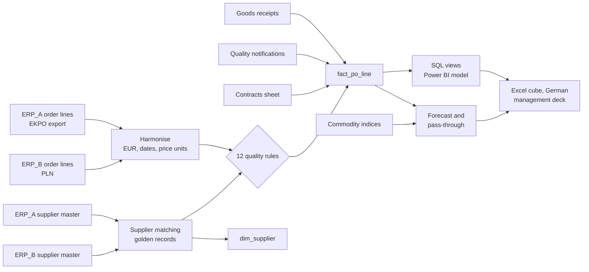

# Data governance for procurement data

How the data in this project flows, who is responsible for it, and how quality is checked. The company is fictional; roles are named, people are not.

## Lineage

## Ownership (RACI)

| Data object | Accountable | Responsible for changes | Consulted | Informed |
|---|---|---|---|---|
| Supplier master (both ERPs) | Head of procurement operations | Supplier master data team | Compliance, accounts payable | Category buyers |
| Order lines ERP_A | Procurement operations, plants Berlin and Erfurt | Buyers | IT (ERP_A) | Controlling |
| Order lines ERP_B | Purchasing lead, plant Gdansk | Buyers | IT (ERP_B) | Controlling |
| Material groups and categories | Category management | Category buyers | Controlling | Plants |
| Contracts sheet | Category management | Category buyers | Legal | Buyers, accounts payable |
| Goods receipts | Plant logistics | Receiving | Quality | Buyers |
| Commodity indices | Category management | Procurement analytics | Market data vendor | Controlling |
| Spend cube and reports | Procurement analytics | Procurement analytics | Category management | Management |

## Definitions

| Term | Definition |
|---|---|
| Spend | Quantity × unit price in EUR on order lines, returns excluded. PLN converted at a fixed planning rate (4.30). |
| On contract | The supplier has a framework agreement for the line's category that is valid on the order date. |
| Maverick spend | Spend not on contract in a category where at least one agreement exists. Split into "agreement expired" and "no agreement". |
| Golden supplier | One record per real company after matching both ERPs by VAT ID or normalised name. |
| On time | Goods receipt no more than 2 days after the requested delivery date. Receipts dated before the order are excluded. |
| Pass-through | Share of a material's price that moves with its commodity index, estimated from the company's own order lines. |

## Quality management

Rules live in `config/dq_rules.yaml`, each with a DAMA dimension, a severity, an owner role and an action. The pipeline runs all of them on every load and writes `outputs/dq_results.csv` and a pass-rate scorecard by dataset and dimension. A rule is fixed at the source where possible (ERP_B material group made mandatory, one payment terms catalogue), and corrected in the pipeline only where the fix is unambiguous (per-tonne prices, duplicate export lines). Supplier near-matches that conflict on VAT ID or legal form are never merged automatically; they go to `outputs/supplier_review_queue.csv` for the master data team.

## Privacy

Supplier records describe companies, not people, and contain no contact persons. If contact data were added, it would stay out of the analytics layer (GDPR, data minimisation) and be accessible only to the supplier master data team.
