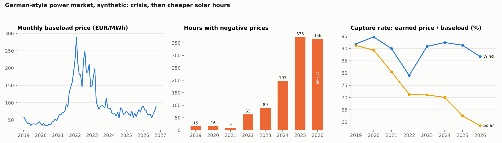
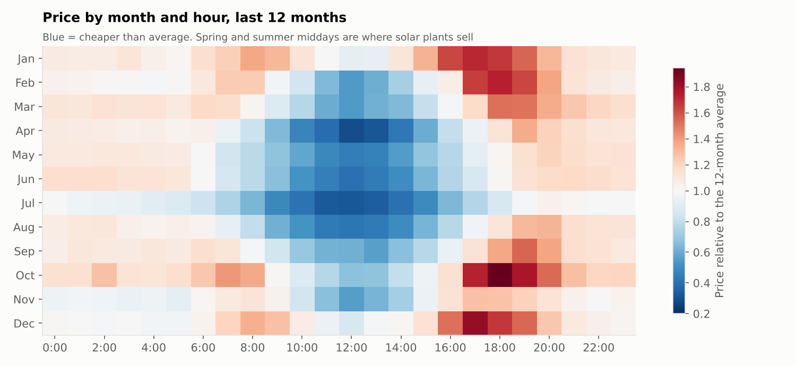
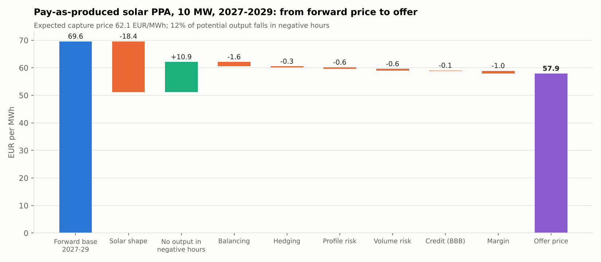
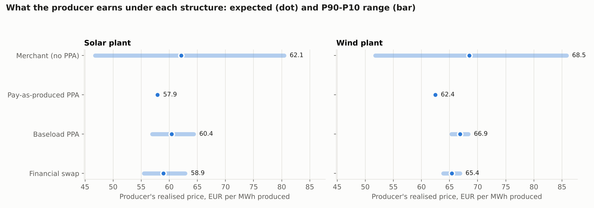
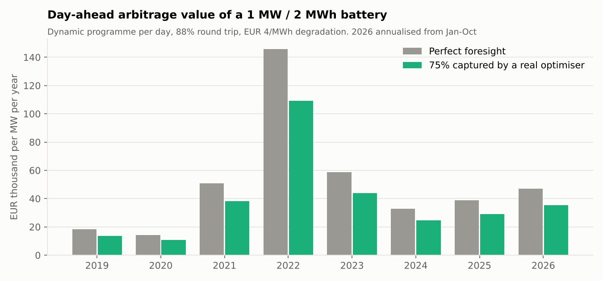
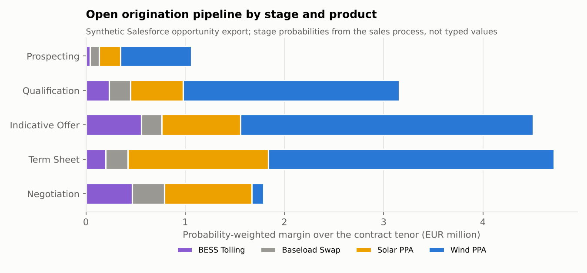

# PPA pricing and power market analyzer

The analysis an origination desk runs before quoting a power purchase agreement (PPA):
- how the market has moved;
- what a solar or wind plant actually earns;
- what price to offer and why;
- how pay-as-produced, baseload and swap structures split the risk between producer and buyer;
- what a battery adds.

It also covers the weekly side of the job: a Salesforce pipeline report with data checks, and a market report in German that one command refreshes.

The market is simulated. A simple merit-order model turns gas and carbon prices, demand, and growing solar and wind capacity into hourly prices for a German-style market from 2019 to October 2026. The shape is realistic: the 2022 crisis, cheap summer middays, more negative hours every year, solar earning less than baseload. The numbers are not exchange data, and every customer and deal in the pipeline is invented.

| Notebook | What it shows | Open |
|---|---|---|
| 1. Market trends and volatility | price levels, peak-base spread, negative hours, capture rates, hour-by-month heatmap, forward volatility | [](https://colab.research.google.com/github/mohammedelsayed741996-blip/berlin-data-portfolio/blob/main/energy-trading/ppa-pricing-market-analyzer/notebooks/01_market_trends_and_volatility.ipynb) |
| 2. PPA pricing and structures | hourly price forward curve, Monte Carlo, offer price walk, structure comparison | [](https://colab.research.google.com/github/mohammedelsayed741996-blip/berlin-data-portfolio/blob/main/energy-trading/ppa-pricing-market-analyzer/notebooks/02_ppa_pricing_and_structures.ipynb) |
| 3. BESS, pipeline and automation | battery arbitrage, solar plus storage, CRM checks and forecast, the weekly report | [](https://colab.research.google.com/github/mohammedelsayed741996-blip/berlin-data-portfolio/blob/main/energy-trading/ppa-pricing-market-analyzer/notebooks/03_bess_pipeline_and_automation.ipynb) |

## Kurzfassung (Deutsch)

Ein synthetischer Strommarkt nach deutschem Vorbild (2019 bis Oktober 2026) zeigt die Krise 2022, den Rückgang des Peak-Base-Spreads und den Wertverfall von Solarstrom: Die Solar Capture Rate fällt von 91 % auf 63 % (2025), negative Stunden steigen von 15 auf 373 pro Jahr. Für einen 10-MW-Solarpark mit Lieferung 2027 bis 2029 ergibt die Monte-Carlo-Bewertung ein Pay-as-produced-Angebot von 57,91 €/MWh, für Wind 62,45 €/MWh, jeweils mit nachvollziehbarer Herleitung vom Terminpreis. Ein Batteriespeicher (1 MW / 2 MWh) hätte 2025 rund 29.000 € pro MW durch Arbitrage verdient. Der Wochenbericht (`outputs/weekly_market_report_de.md`) und der Excel-Angebotsrechner werden mit einem Befehl aktualisiert.

## Market trends



| Year | Base (€/MWh) | Peak minus base | Negative hours | Solar capture rate | Wind capture rate |
|---|---|---|---|---|---|
| 2019 | 42.5 | 9.3 | 15 | 91% | 92% |
| 2022 | 203.0 | 33.7 | 63 | 71% | 79% |
| 2024 | 71.8 | 0.5 | 197 | 70% | 92% |
| 2025 | 70.9 | -0.4 | 373 | 63% | 91% |

The capture rate is what a plant earns per MWh divided by the baseload price. Solar loses ground because all solar plants produce at the same hours and push those prices down. Wind is affected less. The peak product, which used to be the expensive part of the day, now trades at about the base price, because solar covers the middle of every working day.



The Cal-27 baseload contract trades at €72.33/MWh, with an annualised volatility of 29% over the last 60 trading days.

## Pricing a pay-as-produced PPA

The offer is for 10 MW, delivery 2027 to 2029, with a BBB counterparty. It is built in four steps:

1. An hourly price forward curve takes its shape from the last 24 months and is scaled so it averages exactly to the traded Cal-27 base and peak.
2. A fundamental Monte Carlo simulates each delivery year 100 times. Each run uses that year's installed solar and wind capacity and new weather, and rescales the price level to the forward with a shock whose spread grows with time to delivery. Simulating the system, rather than reusing past years, keeps the link between sunny hours and low prices.
3. The plant's expected capture price comes out of those runs. The plant does not produce, and is not paid, in negative hours.
4. The originator hedges the price level with baseload futures and charges for what a hedge cannot cover: balancing, profile risk, volume risk, credit and a margin. Risk premia are 0.5 times the standard deviation across scenarios.



| €/MWh | Solar | Wind |
|---|---|---|
| Forward base 2027-29 | 69.59 | 69.59 |
| Shape (produces in cheap hours) | -18.37 | -4.42 |
| No output in negative hours | +10.88 | +3.35 |
| Expected capture price | 62.10 | 68.53 |
| Balancing, hedging, profile, volume, credit, margin | -4.19 | -6.08 |
| Offer price | 57.91 | 62.45 |

About 12% of the solar plant's possible output falls in negative hours by 2027-29, against 3% for wind. The model assumes batteries absorb about 4 GW more surplus each year from 2026. If that build-out is slower, solar capture falls further, and this is the assumption I would test first with a desk's own fundamental view.

## Who carries which risk

The same 100 scenarios, seen from the producer:



| Producer's price, €/MWh | Solar expected | Solar P90 to P10 | Wind expected | Wind P90 to P10 |
|---|---|---|---|---|
| Merchant, no PPA | 62.10 | 46.79 to 80.42 | 68.53 | 51.79 to 85.80 |
| Pay-as-produced PPA | 57.91 | fixed | 62.45 | fixed |
| Baseload PPA | 60.42 | 56.95 to 64.34 | 66.88 | 65.35 to 68.33 |
| Financial swap (plus direct marketing fee) | 58.92 | 55.45 to 62.84 | 65.38 | 63.85 to 66.83 |

Pay-as-produced costs the solar producer about €4/MWh against merchant in an average year and removes all uncertainty. A baseload PPA hedges the price level but leaves the shape with the producer. For wind that residual risk is small. For solar it is not, because the plant has to buy back the baseload band every night and on cloudy days.

`outputs/ppa_offer_calculator.xlsx` reproduces the offer walk with live formulas. Technology, capacity, tenor, rating, margin and hedging cost are inputs, so the price can be adjusted in a client meeting. I checked the formulas by recalculating the workbook in LibreOffice, and the result matched the Python model within €0.10/MWh. The only difference is a simplified credit term.

## Batteries

A 1 MW / 2 MWh battery is optimised day by day with a small dynamic programme: 88% round trip and €4/MWh degradation, with perfect foresight on day-ahead prices.



It would have earned about €38,700 per MW in 2025 with perfect foresight. At 75%, which is closer to what a real optimiser captures, that is about €29,000. Placed next to a 10 MW solar park, a 5 MW / 10 MWh battery that moves midday output into the evening raised the plant's price by about €15/MWh in 2025. That is the case for hybrid PPAs.

## Pipeline reporting

`data/raw/salesforce_opportunities.csv` is laid out like a Salesforce opportunity report: 220 opportunities across solar PPAs, wind PPAs, BESS tolling and baseload swaps. Before anything is reported, five checks run:

| Check | Opportunities |
|---|---|
| Close date missing | 6 |
| Probability does not match the stage | 5 |
| Volume is zero | 4 |
| Open, but the close date has passed | 52 |
| Open, no activity for 60+ days | 43 |

The forecast weights each deal by the probability of its stage, not the typed value, because typed probabilities drift. It reports weighted margin by close quarter against a target: 89% coverage for the current quarter. Almost half of the open pipeline has a close date in the past, and I would clean that up before trusting any forecast.



## Automation

`python -m ppalab.run` refreshes everything in about ten seconds:
- market statistics;
- the forward curve and Monte Carlo;
- offers for both technologies;
- structure comparison and battery value;
- CRM checks and forecast;
- figures, the Excel calculator and the weekly report.

The weekly report, in German, compares the last week with the one before. It covers base, peak, negative hours, solar capture and spreads, the Cal-27 move, indicative PPA prices, the pipeline and CRM data issues. CI runs the tests and the full refresh on every push.

## What this does not do

- Prices are simulated, so the offers show the method, not a market quote.
- There is no intraday or balancing market. Balancing costs are fixed assumptions, and the battery earns only day-ahead arbitrage.
- Credit risk is a simple expected-loss term. A desk would use its own credit limits and collateral terms.

## Run it

```bash
pip install -r requirements.txt
PYTHONPATH=src python -m pytest -q                 # 16 tests, data regenerated in a temp folder
PYTHONPATH=src python -m ppalab.run --regenerate   # refresh everything into outputs/
PYTHONPATH=src python scripts/build_notebooks.py
```

## Layout

```
src/ppalab/
  market.py      merit-order simulation, delivery-year scenarios, forward curve and Cal-27 history
  trends.py      yearly and monthly statistics, capture rates, volatility, hour-by-month profile
  pricing.py     hourly price forward curve, Monte Carlo, offer walk, structure comparison
  bess.py        battery dynamic programme, solar plus storage
  crm.py         Salesforce-style export, checks, pipeline, forecast, win rates
  reporting.py   figures, Excel offer calculator, German weekly report
  run.py         one command to refresh everything
```
