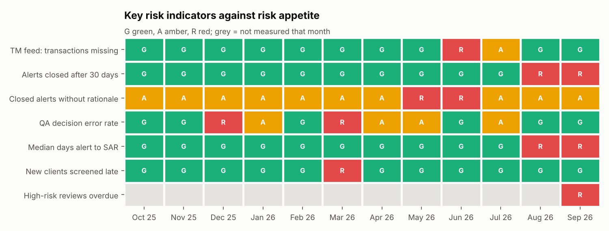
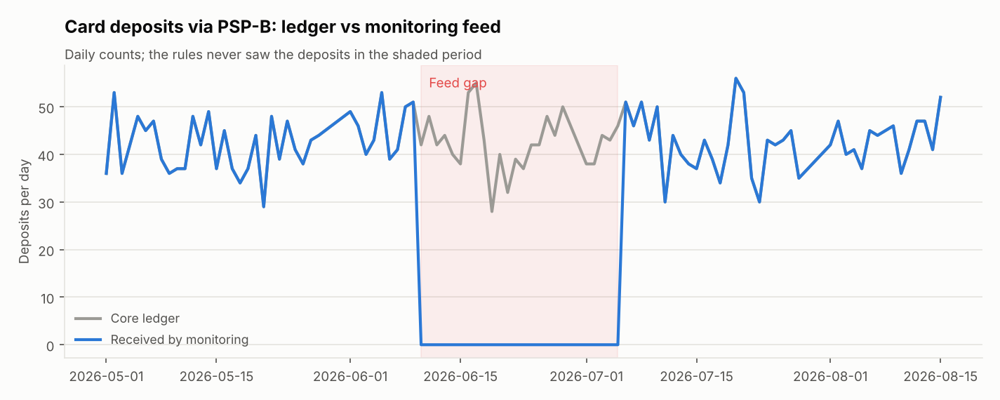
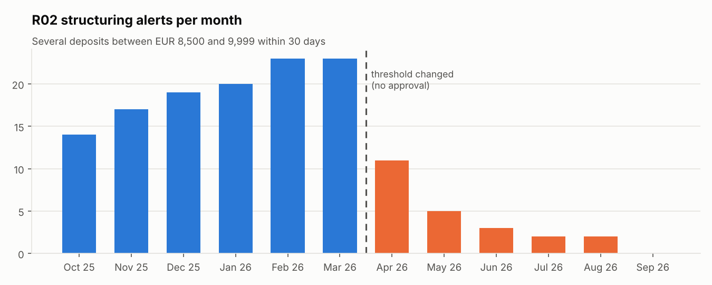
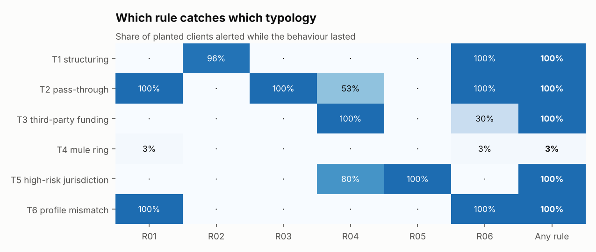
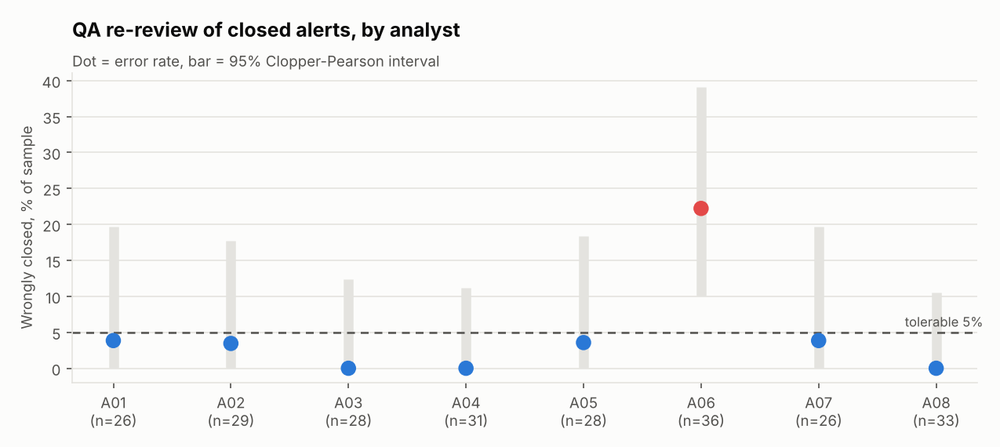

# AML transaction monitoring oversight and MI

[](https://colab.research.google.com/github/mohammedelsayed741996-blip/berlin-data-portfolio/blob/main/fintech-brokerage/aml-monitoring-oversight/notebooks/01_programme_and_data.ipynb)
[](https://colab.research.google.com/github/mohammedelsayed741996-blip/berlin-data-portfolio/blob/main/fintech-brokerage/aml-monitoring-oversight/notebooks/02_oversight_checks.ipynb)
[](https://colab.research.google.com/github/mohammedelsayed741996-blip/berlin-data-portfolio/blob/main/fintech-brokerage/aml-monitoring-oversight/notebooks/03_mi_and_reporting.ipynb)

An AML oversight team does not run transaction monitoring. It checks that the monitoring works, and it reports to the MLRO, senior management and the board when it does not. This project builds that second-line programme for a fictional mobile broker in Germany: a year of data, the first-line monitoring with its problems, the oversight checks that find them, and the monthly MI and report that come out of it.

I built it for an AML oversight working-student role at a broker. The job covers oversight of transaction monitoring and screening, alert checking, MI for the oversight programme, SAR support and reporting to senior management, and this project works through each of those.

All data is synthetic. The 15,000 clients have random syllable names, accounts and devices are random hashes, the analysts are codes A01 to A08, and HR1 to HR4 stand in for high-risk jurisdictions. No real person, sanctions list or country assessment is used.

## The setup

- 15,000 clients with a risk rating, declared income and expected activity, and about 328,000 deposits, trades and withdrawals from October 2025 to September 2026.
- Six typologies planted in 166 clients: structuring under EUR 10,000, pass-through, third-party funding, mule rings, money from high-risk jurisdictions, and activity far above declared income. Legitimate clients look odd sometimes too (an inheritance, a monthly saving of EUR 9,000, a parent paying in), so the rules raise false positives.
- First line: six monitoring rules, 1,919 alerts handled by eight analysts with level 1 and level 2 decisions, rationales and SAR dates; fuzzy name screening with 1,228 hits against a fictional sanctions and PEP list.
- Problems built into the first line, as an oversight team would meet them: a feed that dropped card deposits from one payment provider for almost four weeks, a rule threshold changed without approval, one analyst who closes too many real cases, another who skips rationales, a summer backlog, a screening batch that ran days late, overdue high-risk reviews, and one sanctions hit closed as a false positive.

## What oversight found

The checks found every planted problem and turned them into nine findings with owners and due dates.

| ID | Severity | Finding |
|---|---|---|
| F05 | Critical | A sanctions hit (name score 0.93, same year of birth) was closed as a false positive. The reviewer judges it a true match with a spelling variant |
| F01 | High | 1,016 card deposits (EUR 443,000) never reached transaction monitoring between 10 June and 5 July |
| F03 | High | No rule covers mule rings. Six groups of six clients share a payout account or device; the rules alerted on 1 of 36 members, for an unrelated deposit |
| F02 | High | R02 structuring alerts fell 80% from April (p < 0.001). The vendor had raised the deposit count from 3 to 5 without a change request |
| F04 | High | QA found analyst A06 wrongly closing 22% of sampled cases (95% interval 10% to 39%) against 2% for the others. A full lookback found the analyst's missed cases |
| F06 | Medium | Alerts closed after more than 30 days reached 35% in August; median time from alert to SAR rose to 53 days by September |
| F07 | Medium | Closed alerts without a rationale, mostly from one analyst |
| F08 | Medium | 62 new clients screened four to seven days late during a batch outage |
| F09 | Medium | 43 high-risk clients past their annual review |



## How the checks work

Data completeness comes first, because every other check assumes the monitoring saw all the transactions. A daily reconciliation of the core ledger against the monitoring feed, by source, shows the gap at once.



Rule governance means watching each rule's alert volume and asking why it moved. R02 fell from about 19 alerts a month to 4. A below-the-line test re-runs the rule since April at lower deposit counts: at the approved setting of 3 it would have caught 14 structuring clients, against 7 at the current setting. The lower setting also brings more false positives, which may be why it was changed. That trade-off has to be decided and documented, though, and not set quietly in a vendor console.



Coverage is checked typology by typology. Five are caught, most by two rules. The mule rings are not: their money comes from the client's own card and is traded before it leaves. What gives them away is shared infrastructure, so a link analysis on payout accounts and devices finds all six rings (`sql/04_shared_payout_accounts.sql` does the same in four lines of SQL).



Decision quality is tested by re-reviewing a sample of closed alerts each quarter. With 59 cases and no errors you can state with 95% confidence that the error rate is below 5%, so that is the quarterly sample, spread across analysts. Per analyst the samples are small, so error rates come with Clopper-Pearson intervals. Only A06's whole interval sits above 5%, which is the evidence needed to justify a full lookback of that analyst's work.



## Outputs

| File | What it is |
|---|---|
| `outputs/aml_oversight_mi.xlsx` | MI pack: KRI dashboard with RAG by formula against the limits, alert KPIs, rule effectiveness, typology coverage, QA results, findings register, feed reconciliation, screening and reviews. Inputs are blue, everything else is a formula |
| `outputs/oversight_report.md` | One-page report for senior management and the Risk & Compliance Committee, with a German summary (Kurzfassung für die Geschäftsleitung) |
| `outputs/findings_register.csv` | The nine findings with severity, owner, due date and status |
| `sql/` | Feed reconciliation, alert backlog by analyst, rule effectiveness, shared payout accounts and overdue reviews in SQL; the tests check they agree with the Python |

## Notebooks

| Notebook | Content |
|---|---|
| [01 Programme and data](notebooks/01_programme_and_data.ipynb) | Clients, activity, the planted typologies, rules, alerts, the case system and screening |
| [02 Oversight checks](notebooks/02_oversight_checks.ipynb) | Feed completeness, rule volumes and the below-the-line test, typology coverage and network analysis, QA sampling and lookback, timeliness, screening QA, periodic reviews |
| [03 MI and reporting](notebooks/03_mi_and_reporting.ipynb) | KRIs against risk appetite, findings register, Excel MI pack, management report |

The notebooks are saved with their outputs. In Colab the first cell clones this repository, so they run without setup.

## Run it

```bash
cd fintech-brokerage/aml-monitoring-oversight
pip install -r requirements.txt
python -m pytest                                        # 22 tests, about 80 seconds
PYTHONPATH=src python -m aml_oversight.pipeline --regenerate
python scripts/build_notebooks.py
```

```
src/aml_oversight/
  config.py      clients, typologies, rules, the planted problems, SLAs, risk appetite limits
  world.py       clients, transactions, typologies, fictional watchlist
  monitoring.py  first line: feed, six rules, alert handling, screening
  oversight.py   second line: completeness, KPIs, QA sampling, rule tests, coverage, networks, KRIs, findings
  reporting.py   charts, Excel MI pack, management report
  db.py          SQLite runner for sql/
  pipeline.py    runs everything
```

## Limits

- Ground truth stands in for the QA reviewer's judgement in the sampled re-reviews. In practice that judgement is the hard part, and it needs a written QA methodology and calibration sessions between reviewers.
- The rules are simple versions of common scenarios. A real system has dozens, with segment-specific thresholds tuned on data.
- Screening uses one name-similarity score and the year of birth. Real engines add transliteration, aliases, dates of birth and nationality.
- SAR content and FIU reporting (goAML in Germany) are out of scope; the project tracks only whether and when a SAR was filed.

Mohamed Abdelrasoul · MSc Data Analytics, Berlin · [LinkedIn](https://linkedin.com/in/mohamed-abdelrasoul-b07002173)
