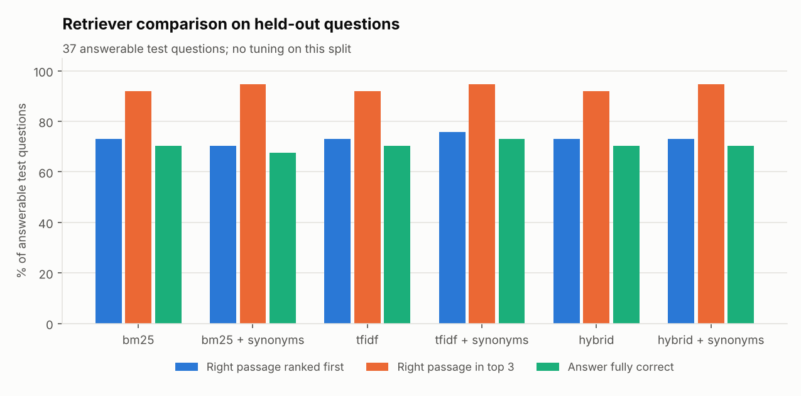
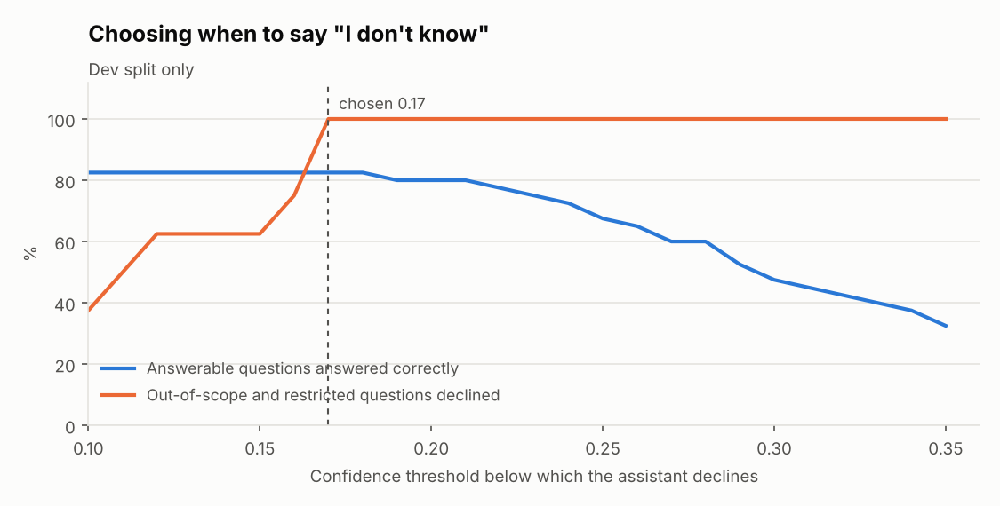

# HR policy assistant: answers with sources, knows when to say "I don't know"

[](https://colab.research.google.com/github/mohammedelsayed741996-blip/berlin-data-portfolio/blob/main/hr-tech/hr-policy-rag-assistant/notebooks/01_corpus_retrieval_and_access.ipynb)
[](https://colab.research.google.com/github/mohammedelsayed741996-blip/berlin-data-portfolio/blob/main/hr-tech/hr-policy-rag-assistant/notebooks/02_evaluation.ipynb)
[](https://colab.research.google.com/github/mohammedelsayed741996-blip/berlin-data-portfolio/blob/main/hr-tech/hr-policy-rag-assistant/notebooks/03_service_privacy_and_llm.ipynb)

HR teams answer the same questions every day. How many vacation days do I have? When do I need a doctor's note? What is the night shift allowance? This project is a retrieval-augmented assistant that answers them from the company's own policies, cites the section it used, refuses when the policies do not cover the question, and never shows a manager-only or HR-only document to someone who may not see it.

It is built to be used, not only demoed:
- a web service with a TypeScript front end,
- PostgreSQL for the question log,
- a Docker image and Kubernetes manifests,
- a CI pipeline that fails the build if answer quality drops or a restricted document leaks.

The knowledge base is 13 HR policies of a fictional car maker, Northlake Motors GmbH, written for this project. No real company's documents and no personal data are used.

## What it does



- **Answers with sources.** Every answer quotes the policy and cites the section, version and effective date, so the employee can check it.
- **Declines when it should.** If the best passage scores below a threshold, the assistant says it could not find the answer and points to HR. The threshold was tuned on a separate set of questions.
- **Respects roles.** Passages are removed before ranking when the user's role may not read them. In production the role comes from the identity proxy, so the browser cannot claim to be HR.
- **Keeps personal data out.** Names, employee IDs, emails, phone numbers, IBANs, tax IDs and dates are removed from questions before they are answered or stored. The log keeps no user ID and is deleted after 90 days.
- **Works with or without an LLM.** By default it answers by quoting the best sentences, so it runs offline and in CI. Set three environment variables to use any OpenAI-compatible model instead. The model sees only the retrieved passages, and a reply that cites nothing, or cites a passage it was not given, is replaced by the quoted answer.

## How well it works

I wrote 93 questions the way employees ask them, with informal wording, German words like Urlaub or Krankmeldung, and typos. 77 have an answer in the policies, each with the passage it should cite and the facts the answer must contain. 16 should be declined: 10 are out of scope, and 6 ask for manager or HR content with a role that may not see it.

Half the questions were used for every design decision and for the decline threshold. The other half were held back.

| On the 45 held-out questions | Result | CI gate |
|---|---:|---:|
| Answer correct (right section cited, every expected fact included) | 70% | at least 65% |
| Right section among the top 3 retrieved | 95% | at least 90% |
| Right section ranked first | 73% | |
| Out-of-scope and restricted questions declined | 100% | at least 95% |
| Answerable questions wrongly declined | 3% | |
| Restricted sections cited | 0 | exactly 0 |
| Response time, 95th percentile | 2 ms | |

On the questions used for tuning, 83% of answers were correct. The drop to 70% on held-out questions is the more honest number. In most misses the right section was ranked second or third, which is where an LLM that reads all four retrieved passages, or a reranker, should help.

One rule was added after the test numbers were first measured: a smoke test showed that "how many vacation days do I get?" landed on the wrong section, so "how many/how much" questions about leave now point to the entitlement section. The test numbers above were measured again afterwards and did not change.



The full report, with every miss listed, is in [outputs/eval_report.md](outputs/eval_report.md).

## Run it

```bash
cd hr-tech/hr-policy-rag-assistant

# locally, with SQLite
pip install -r requirements.txt
PYTHONPATH=src python -m hrrag.api            # http://localhost:8000

# the full stack, with PostgreSQL
docker compose up --build

# Kubernetes (create the Secret from deploy/k8s/secret.example.yaml first)
kubectl apply -f deploy/k8s/

# tests and the evaluation gate
python -m pytest                              # 37 tests, about 2 seconds (one needs PostgreSQL)
PYTHONPATH=src python scripts/evaluate.py --gate
```

To use an LLM, set `LLM_BASE_URL`, `LLM_API_KEY` and `LLM_MODEL` for any OpenAI-compatible endpoint, for example a self-hosted model or a provider in the EU.

CI runs the tests on Python 3.11 and 3.12, a PostgreSQL integration test, the evaluation gate and a TypeScript type check. It then builds the Docker image, starts the container, and asks it a real question through HTTP.

## API

| Method and path | What it does |
|---|---|
| `GET /health` | Liveness and readiness; used by Kubernetes probes and the Docker health check |
| `POST /api/ask` | `{"question": "...", "session": "..."}` returns the answer, citations, confidence and a query id |
| `POST /api/feedback` | `{"query_id": 12, "helpful": true}` |
| `GET /api/policies` | Policies the current role may read |
| `GET /api/stats` | Usage and feedback counts, HR role only |

## Project layout

```
policies/            13 fictional HR policies in Markdown, with version, effective date and audience
src/hrrag/
  corpus.py          load policies, cut them into sections with metadata
  text.py            tokenising, stemming, English-German synonyms, question patterns
  retrieval.py       role filter, BM25, TF-IDF, hybrid ranking, confidence
  answer.py          extractive answerer, optional LLM answerer with citation checks, decline logic
  privacy.py         removing personal data from questions
  store.py           question and feedback log in SQLite or PostgreSQL, 90-day retention
  api.py             Starlette app: API, rate limiting, roles, web UI
  evaluate.py        retrieval and answer metrics, threshold calibration, retriever comparison
web/                 TypeScript front end (compiled to web/dist)
eval/                the 93 evaluation questions and the script that writes them
deploy/k8s/          Deployment, Service, ConfigMap, autoscaler, Secret template
docs/                architecture and privacy notes
```

## Limits

- The policies are fictional and much shorter than a real handbook. A real corpus would need PDF and intranet ingestion, and re-indexing when a policy changes.
- Retrieval uses keyword and character models, not neural embeddings. That suits a small corpus with specific vocabulary, but a reranker or embeddings are the next step for the 27% of questions where the right section is not ranked first.
- The LLM path is tested with a fake model for its guardrails, not evaluated on answer quality, because this project runs without network access to a model.
- Redaction is pattern-based and will miss unusual ways people describe themselves.
- In Germany, a system like this needs the works council's agreement before launch, even though it stores no identities. The [privacy notes](docs/privacy_and_security.md) list what was done and what is still needed.

Mohamed Abdelrasoul · MSc Data Analytics, Berlin · [LinkedIn](https://linkedin.com/in/mohamed-abdelrasoul-b07002173)
