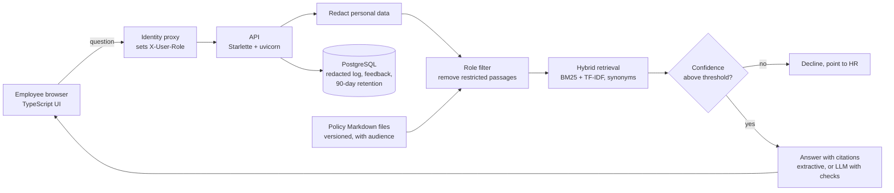

# Architecture

## Request path

1. The browser sends the question. In production the company's single sign-on proxy adds the user's role in the `X-User-Role` header; the browser cannot set it. In demo mode the role can be picked in the page.
2. Personal data in the question (names, employee IDs, email addresses, phone numbers, IBANs, tax IDs, dates) is replaced with tags before anything else happens.
3. Passages the role may not read are removed. Ranking only ever sees what the user is allowed to see.
4. Hybrid retrieval ranks the remaining passages: BM25 on stemmed words, TF-IDF on words and character n-grams, combined by reciprocal rank fusion. Queries are expanded with the policies' own words (Urlaub to annual leave, Krankmeldung to medical certificate).
5. If the best passage scores below the threshold chosen on the dev questions, the assistant declines and points to HR.
6. Otherwise it answers with numbered citations. The default answerer quotes the best sentences. With an LLM configured, the model gets only the retrieved passages; a reply without valid citations is replaced by the quoted answer.
7. The redacted question, the cited passages, latency and any feedback are stored. Rows are deleted after 90 days.

## Why these choices

- Extractive answers by default: they cannot say anything that is not in a policy, they need no external service, and they make the system testable in CI. An LLM improves fluency and can use several passages, and the guardrails keep it inside the same limits.
- Sections as passages: a citation then points to something a person can open and check, with the policy version and effective date.
- Keyword and character models instead of neural embeddings: the corpus is small, the vocabulary is specific, and the evaluation shows the right passage in the top 3 for 95% of held-out questions. A cross-encoder reranker or embeddings are the next step for the cases where the right passage is ranked second or third.
- Access control before ranking, not after: a restricted passage that is ranked and then hidden can still leak through scores or timing. Removing it first makes the zero-leak test a property of the design.

## Deployment

| Piece | File |
|---|---|
| Container image (multi-stage: TypeScript build, Python runtime, non-root user, health check) | `Dockerfile` |
| Local stack with PostgreSQL | `docker-compose.yml` |
| Kubernetes: Deployment with probes and resource limits, Service, ConfigMap, autoscaler, Secret template | `deploy/k8s/` |
| CI: tests, evaluation gate, TypeScript check, PostgreSQL integration test, image build and container smoke test | `.github/workflows/ci.yml` (repository root) |
