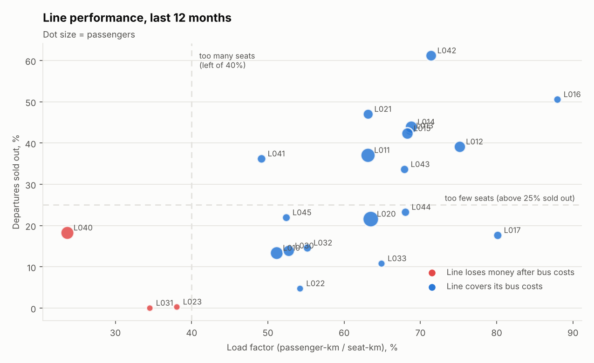
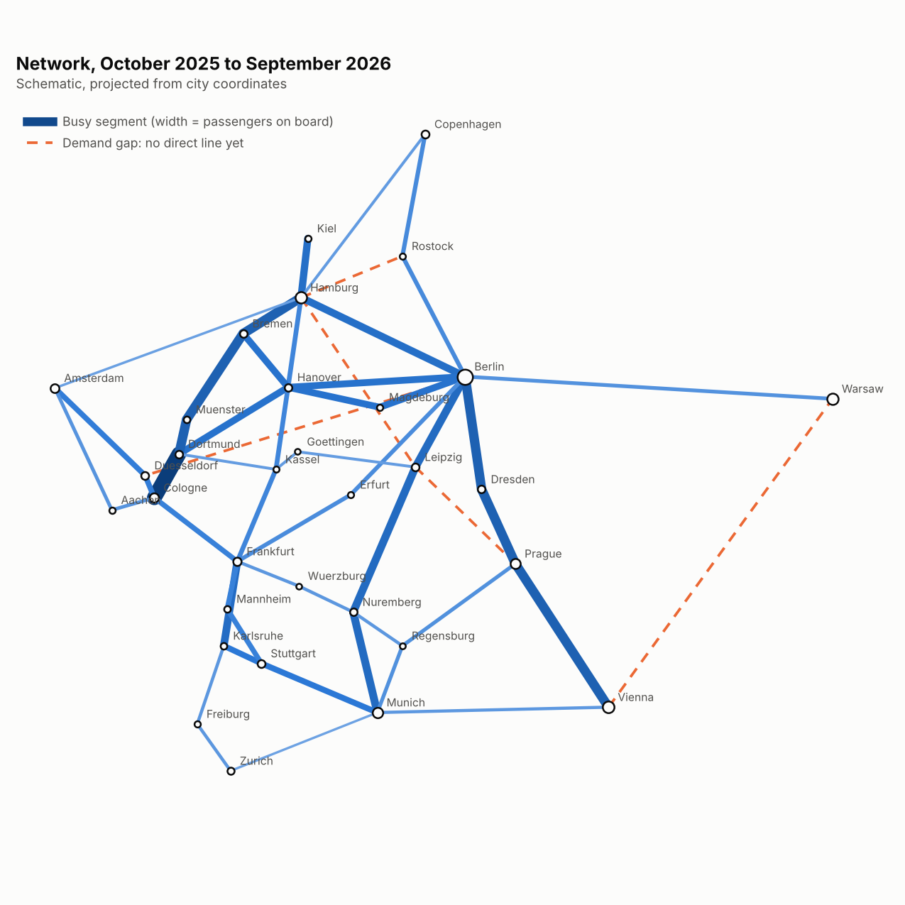
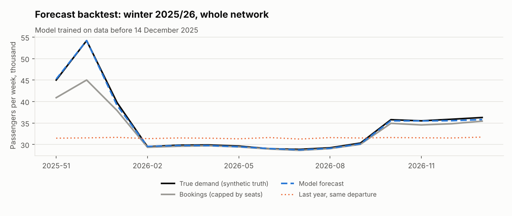
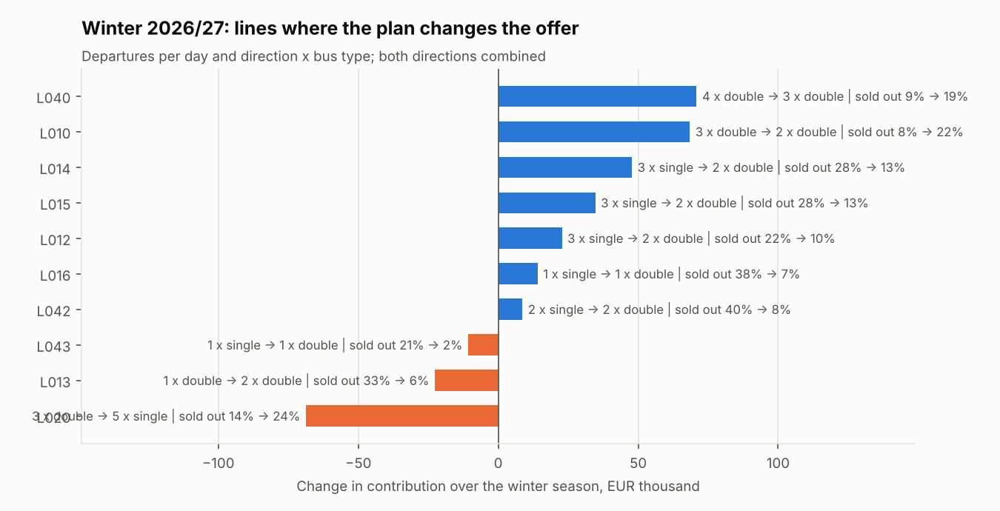

# Intercity bus network: data validation, demand and offer planning

[](https://colab.research.google.com/github/mohammedelsayed741996-blip/berlin-data-portfolio/blob/main/mobility/bus-network-demand-planning/notebooks/01_data_validation.ipynb)
[](https://colab.research.google.com/github/mohammedelsayed741996-blip/berlin-data-portfolio/blob/main/mobility/bus-network-demand-planning/notebooks/02_network_and_line_performance.ipynb)
[](https://colab.research.google.com/github/mohammedelsayed741996-blip/berlin-data-portfolio/blob/main/mobility/bus-network-demand-planning/notebooks/03_forecast_and_winter_plan.ipynb)

A network planner decides how many buses run on each line, how big they are and when they leave. Those decisions rest on data from systems that rarely agree with each other, so most of the job is checking the data, reading the network and then planning the offer from demand. This project does all three for a fictional intercity bus operator with 22 lines between 32 cities in Germany and its neighbours.

I built it for a working-student role in transport network planning. The role covers data entry, tracking and validation across tools, Excel reports and maps, network analysis across several datasets, and planning the offer from demand, and the project follows that order.

All data is synthetic. City coordinates and populations are public geography; the nine bus partners are invented and carry "(fictional)" in their names. Bookings are counts per trip, so there is no passenger data of any kind.

## The setup

- 22 lines and 80 daily departures from January 2024 to September 2026, run by nine partners with single-deckers (49 seats) and double-deckers (79 seats). About 80,000 trips in total.
- Demand follows a gravity model: more passengers between big cities, fewer over long distances, less across borders, with seasons, weekdays, holidays, Easter and a growth trend per line.
- Four systems that should agree: the planning tool (stops, lines, timetable), the partner CRM (contracts and fleets), the operations log (what ran, with which bus) and ticketing (bookings per trip and per origin-destination pair).
- Six problems planted in those systems, the kind a planning team meets in practice: a stop with swapped coordinates, a stop stored twice, trips missing from the operations log, bookings on a departure that is not in the timetable, a partner running smaller buses than ticketing sells, and a partner still driving after its contract ended.

## What the checks found

Eight checks run before any KPI. Each returns the failing rows with an owner and an action, and all six planted problems were found with the exact count.

| Check | Finding |
|---|---|
| V05 | Since 1 April 2026 the partner on L017 runs single-deckers while ticketing still sells 79 seats. 314 of 362 trips were overbooked, by up to 30 seats |
| V06 | Partner P07 kept running 1,279 trips after its contract ended on 30 June 2026 |
| V03 | 140 trips sold tickets but are missing from the operations log, which partner payments are based on |
| V04 | 60 bookings on a 05:45 departure that does not exist in the timetable |
| V01 | Regensburg has latitude and longitude swapped, which puts the stop in the Gulf of Aden |
| V02 | Munich is stored twice, 0.3 km apart, and L031 uses the duplicate |
| V08 | Trip bookings and monthly origin-destination totals differ in 55 line-months, all caused by V04 |

The checks for the log, capacity and contracts also exist as SQL in `sql/`, and a test confirms the SQL and Python versions agree. The full list with owners is in [docs/validation_runbook.md](docs/validation_runbook.md).

## The network

The main KPI is load factor, passenger-km over seat-km for the whole line. Average peak load would hide a line that is full for 40 km and empty for the next 200, and one line here does exactly that. L040 Cologne to Amsterdam has its busiest segment 72% full on average but a load factor of 24%, because most of its passengers ride only from Cologne to Duesseldorf. It is one of three lines that lose money after bus costs, with L023 Hamburg to Amsterdam and L031 Munich to Zurich, which are short of passengers everywhere.

At the other end, L042 Cologne to Stuttgart sells out on 61% of departures and L016 Berlin to Warsaw on 51%.



Frankfurt has the highest betweenness centrality, so a disruption there breaks the most journeys. A gravity model fitted on the served city pairs (R² 0.95) ranks pairs without a direct line: Hamburg to Leipzig comes first, at about 27 expected passengers a day each way, today with a 37% detour and one change.



The network is also exported as [GeoJSON](outputs/network.geojson), which GitHub draws as an interactive map, and as a Leaflet page in `outputs/network_map.html`.

## Demand forecast

Bookings stop at the seat count. On a sold-out bus the people who did not get a seat leave no trace, so a forecast trained on raw bookings plans too few seats where more are needed. Here bookings understate true demand by about 4% over the 2025/26 winter, and by about 10% on L016 and L042, the lines that sell out most.

The model is a log-linear regression per departure with month, weekday, holiday and a trend per line. Sold-out trips are treated as censored and re-estimated until the fit settles. Trained on data before 14 December 2025 and scored on the 2025/26 winter timetable against the true demand that the simulation keeps, its weekly error (WAPE) is 4.5%, against 15.8% for "same departure last year". Total bias is under 1%.



## Winter 2026/27 offer

Every line and direction gets 16 options (1 to 8 departures a day, single or double-decker), each simulated 200 times with demand noise. More departures also attract some extra demand. A mixed-integer program then picks one option per line and direction to maximise contribution under five rules: bus-hours at most 3% above today, at least as many passengers as today, the same offer in both directions, no more double-deckers than each partner owns, and no new option that sells out on more than a quarter of departures.

The plan changes 10 of 22 lines. Against today's timetable for the same season it carries the same number of passengers, raises contribution by 5.0% (EUR 3.30 million to 3.46 million), needs 5.6% fewer bus-hours and lowers the average sold-out share from 17% to 12%.



Most of the gain comes from replacing three single-deckers with two double-deckers: about the same seats with fewer buses and drivers. L016 Berlin to Warsaw moves to a double-decker and its sold-out share drops from 38% to 7%. L020 goes the other way, to five smaller departures, because the plan must keep every passenger and L020 is the cheapest place to add seats. That one is a proposal for a planner to check against depot and driver constraints the model does not know.

## The Excel report

`outputs/network_planning_report.xlsx` has the issue log with an open-issue counter, line KPIs where load factor, contribution and margin are formulas, the winter plan, the demand gaps and monthly passengers per line. Inputs are blue and formulas are black, and the workbook recalculates without errors in LibreOffice.

## Run it

```bash
cd mobility/bus-network-demand-planning
pip install -r requirements.txt
python -m pytest                                        # 21 tests, about 15 seconds
PYTHONPATH=src python -m bus_network.pipeline --regenerate
python scripts/build_notebooks.py
```

```
src/bus_network/
  config.py      cities, lines, bus types, costs, seasons, the planted problems
  world.py       stops, partners, timetable and the trip-level simulation
  data.py        generate, save and load the tables
  validation.py  eight checks, issue log, clean trip table
  analysis.py    line KPIs, network graph, hubs, gravity model, demand gaps
  planning.py    censored demand forecast, backtest, offer options, MILP plan
  reporting.py   charts, map, GeoJSON, Leaflet page, Excel report
  db.py          SQLite runner for sql/
  pipeline.py    runs everything
docs/            data dictionary, validation runbook
```

## Limits

- Planning works per line and direction. A real plan also builds bus rotations and driver duties across lines, which decides whether a proposed timetable can actually run.
- Demand reacts to frequency through one elasticity. Price, competition from rail and new connections are not modelled.
- The road distance is the straight-line distance times 1.22, and driving time assumes 72 km/h on average.
- The real job uses Salesforce for partner data. Here the partner CRM is a table, and the checks are written so they would work on an export from it.

Mohamed Abdelrasoul · MSc Data Analytics, Berlin · [LinkedIn](https://linkedin.com/in/mohamed-abdelrasoul-b07002173)
